# Report 001：VAE潜在空間のサンプリング挙動の診断

## 1. 概要

GHOSTによる顔交換と変分オートエンコーダ (Variational Autoencoder，VAE) を組み合わせた顔匿名化において，サンプリングのスケール係数 $` \alpha `$ を大きくしても，匿名化後の顔ベクトル $` \tilde{\mathbf v} `$ と元の顔ベクトル $` \mathbf v `$ のコサイン類似度 $` \cos(\tilde{\mathbf v}, \mathbf v) `$ が十分に下がらない原因を，ベクトル空間のみで診断した．新しい手法の実装とVAEの再学習は行っていない．結論は次の3点である．

1. **分布の形は原因ではない．** ガウスサンプリングと半径を $` \sqrt{d} `$ に固定したサンプリングの差は，$` \cos(\tilde{\mathbf v}, \mathbf v) `$ の平均で最大 0.0013 であり，効果量は無視できる大きさである．半径の固定は $` \alpha `$ のスケーリングと数値誤差の範囲で一致した．
2. **主因は移動量の小ささである．ただし，不足しているのは潜在空間での距離そのものではなく，出力空間での「ノイズと信号の比」である．** $` \alpha = 2 `$ の移動量は，潜在空間における他画像との最近傍距離を既に超えている．それでも類似度が 0.59 に留まるのは，ランダムな方向への移動が元の成分 $` \mathrm{decoder}(\boldsymbol\mu) `$ を打ち消さず，ほぼ直交する成分を足すだけだからである．
3. **デコーダは鈍感ではない．** デコーダは線形1層であり，潜在空間の移動を平均 1.39 倍に拡大して出力に伝える．不活性な次元は存在しない．

これらの結果，$` \cos(\tilde{\mathbf v}, \mathbf v) `$ は1本の閉形式でほぼ完全に予測できることが分かった．

## 2. 確認した事項

### 2.1 関連するコードと重みの場所

**表1** 診断に関係するファイルの場所

| 対象 | 場所 |
| :---: | :--- |
| VAEのモデル定義 | `src/identity_anonymizer/anonymizers/vae.py` の `VAEAnonymizer` |
| VAEの学習 (ロス関数) | `notebooks/02_train_vae_anonymizer.ipynb` の `train_vae_anonymizer` |
| VAEの学習済み重み | `weights/anonymizers/vae/vae_512_128.pt` |
| ArcFaceの読み込み | `src/identity_anonymizer/faceswap/models.py` の `load_ghost_models` (`iresnet100`，重みは `weights/ghost/backbone.pth`) |
| ArcFaceの推論とUTKFaceの読み込み | `src/identity_anonymizer/data/utkface.py` の `extract_arcface_embeddings_with_paths`，`list_utkface_image_paths` |
| 抽出済みの顔ベクトル | `data/processed/source_embeds.npy` (23,125行) |

### 2.2 潜在次元数

学習済み重みに含まれるテンソルの形状は，`encoder.0.weight` が (128, 512)，`fc_mu.weight` と `fc_logvar.weight` が (128, 128)，`decoder.0.weight` が (512, 128) であった．したがって **潜在次元数は $` d = 128 `$** である．512 は入力と出力，すなわちArcFaceの顔ベクトルの次元数である．

モデルの構造は，エンコーダが `Linear(512, 128)` と ReLU，その後に $` \boldsymbol\mu `$ 用と対数分散用の `Linear(128, 128)` が1層ずつ，デコーダが **活性化関数を持たない `Linear(128, 512)` の1層のみ** である．デコーダが線形であることは，3章以降の解析の前提になる．

### 2.3 エンコーダが出力する σ の意味

エンコーダの出力は **対数分散** $` \log \sigma^2 `$ である．`VAEAnonymizer.reparameterize` は `std = torch.exp(0.5 * logvar)` として標準偏差を計算し，`mu + eps * std * noise_level` を返す．ロス関数のKL項も `logvar.exp()` を分散として用いており，両者は整合している．以下では，標準偏差を $` \mathbf s = \exp(0.5 \cdot \mathrm{logvar}) `$ と書く．$` \alpha `$ は既存実装の `noise_level` に対応する．

### 2.4 ロス関数の形

学習時のロス関数を(1)に示す．

```math
\mathcal{L} = \frac{1}{512 B} \sum_{n=1}^{B} \| \hat{\mathbf v}_n - \mathbf v_n \|^2
            + \frac{\lambda}{512 B} \sum_{n=1}^{B} \sum_{j=1}^{d} \frac{1}{2} \left( \mu_{n,j}^2 + s_{n,j}^2 - 1 - \log s_{n,j}^2 \right)
\tag{1}
```

ここで $` B `$ がバッチサイズ，$` \hat{\mathbf v}_n `$ が再構成された顔ベクトル，$` \lambda = 1 `$ がKL項の重みである．KL項は標準的なガウスKLと同じ形であり，潜在次元数ではなく入力の次元数 512 で割られている．(1)に 512 を掛けると $` \| \hat{\mathbf v} - \mathbf v \|^2 + \mathrm{KL} `$ になるため，分散1のガウス尤度を仮定した標準的な変分下限に対しては，KL項の重みが 0.5 の $` \beta `$-VAEに相当する．学習は，$` \alpha = 1 `$ のサンプリングを行いながら，AdamW，学習率 $` 10^{-4} `$，25エポックで行われている．

### 2.5 データ

`UTKFace.zip` には拡張子が `.jpg` の画像が 24,106 枚含まれる．既存実装と同一の前処理で顔検出に成功したのは **23,125 枚** であり，981 枚は顔が検出されず除外された．抽出した 23,125 本の顔ベクトルは，`data/processed/source_embeds.npy` の 23,125 行と全て一致した (対応する行とのコサイン類似度が全て 0.9999 以上)．したがって，本診断の対象はVAEの学習に用いられたデータと同一である．枚数は想定されていた 23,088 枚より 37 枚多いが，この差の由来は特定できていない．

顔ベクトルは正規化されておらず，ノルムの平均は 22.4 である．また，UTKFaceには人物のラベルが無いため，以下で「他人」と呼ぶものは正確には「他の画像」である．データには重複が含まれ，他の画像と $` \boldsymbol\mu `$ が完全に一致する画像が 419 枚，ArcFace空間で最近傍とのコサイン類似度が 0.9 以上の画像が 1,848 枚あった．最近傍に関する基準値は，この重複の影響を受けにくい中央値で示す．

## 3. 実験条件

**表2** 実験条件

| 項目 | 設定 |
| :---: | :--- |
| 画像数 $` N `$ | 23,125 (うち 2,373 枚がVAEの学習時の検証用データと一致) |
| 潜在次元数 $` d `$ | 128 |
| $` \alpha `$ | 0，1，1.25，1.5，2，3，5 |
| 1枚あたりのサンプル数 $` K `$ | 10 |
| 乱数シード | 0，1，2 (本文の数値はシード0，シード間のばらつきは併記) |
| 評価 | ベクトル空間のみ (GHOSTによる画像生成は行わない) |

サンプリングは $` \mathbf f = \boldsymbol\mu + \alpha \, \mathbf s \odot \mathbf z `$，$` \tilde{\mathbf v} = \mathrm{decoder}(\mathbf f) `$ である．以下，$` \mathbf v_0 = \mathrm{decoder}(\boldsymbol\mu) `$ を $` \alpha = 0 `$ のときの出力と呼ぶ．プログラムは `programs/ex001_vae_latent_diagnosis/`，結果は `outputs/ex001_vae_latent_diagnosis/` にある．既存のコードは変更していない．

## 4. 実験1：潜在次元ごとの統計

想定外の挙動は見つからなかった．**128次元の全てが活性**であり，KLがほぼゼロの次元も，標準偏差が極端な値をとる次元も存在しない．

**表3** 潜在次元ごとの統計の集計

| 指標 | 値 |
| :---: | :---: |
| 活性次元数 ($` \boldsymbol\mu `$ の分散 > 0.01) | 128 / 128 (不活性 0) |
| $` \boldsymbol\mu `$ の分散 (最小 / 中央値 / 最大) | 0.208 / 0.781 / 0.874 |
| 次元ごとの平均KL [nat] (最小 / 中央値 / 最大) | 0.115 / 0.809 / 1.058 |
| KLの合計 [nat] | 101.4 |
| 標準偏差 $` s `$ の全要素 (最小 / 中央値 / 平均 / 最大) | 0.307 / 0.441 / 0.451 / 0.957 |
| 次元ごとの平均標準偏差 (最小 / 最大) | 0.347 / 0.896 |
| $` \| \boldsymbol\mu \| `$ の平均 | 9.86 |
| $` \| \mathbf s \| `$ の平均 ± 標準偏差 | 5.14 ± 0.08 |
| デコーダの重みの特異値 (最大 / 中央値 / 最小) | 2.32 / 1.43 / 0.058 |
| デコーダの重みの列ノルム (最小 / 平均 / 最大) | 0.360 / 1.419 / 1.795 |

図1に標準偏差の分布を示す．横軸は標準偏差 $` s `$，縦軸は度数である．標準偏差は 0.44 付近に集中し，事前分布の標準偏差 1 の半分以下である．$` \| \mathbf s \| `$ は画像によらずほぼ一定 (5.14 ± 0.08) であり，事後分布の広がりは入力にほとんど依存しない．

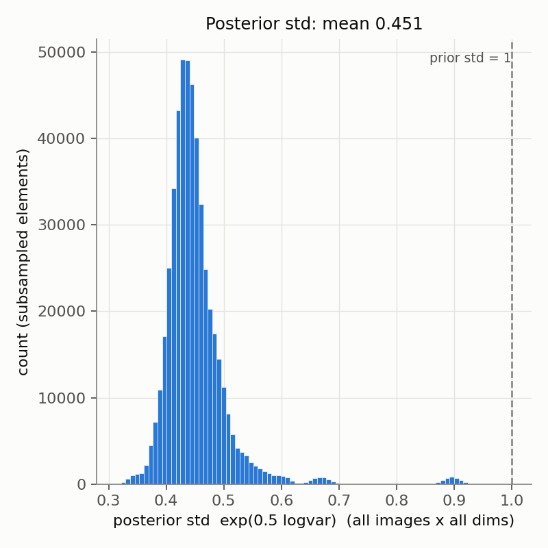

**図1** 事後分布の標準偏差のヒストグラム (全画像 × 全次元)

図2に次元ごとのKLを降順に並べた結果を，図3に $` \boldsymbol\mu `$ の分散と平均標準偏差の関係を示す．図2の横軸はKLの順位，縦軸は次元ごとの平均KLである．図3の横軸は $` \boldsymbol\mu `$ のデータ全体での分散，縦軸は標準偏差の平均であり，破線が活性の閾値 0.01 である．大半の次元は 0.7〜1.0 nat の情報を持ち，情報量が小さいのは1次元 (次元107，KL 0.115 nat，平均標準偏差 0.896) のみである．

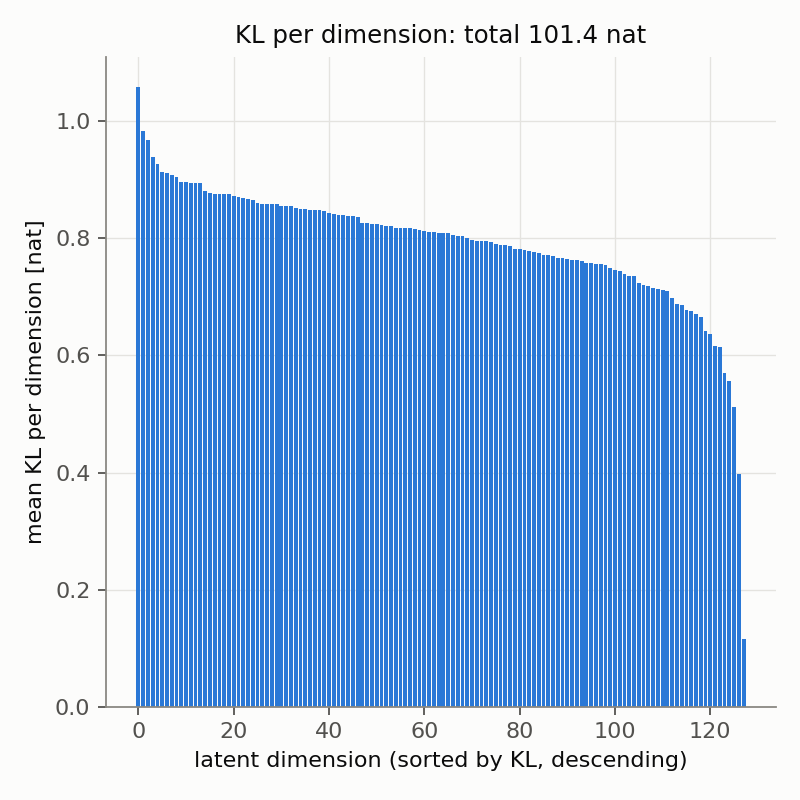 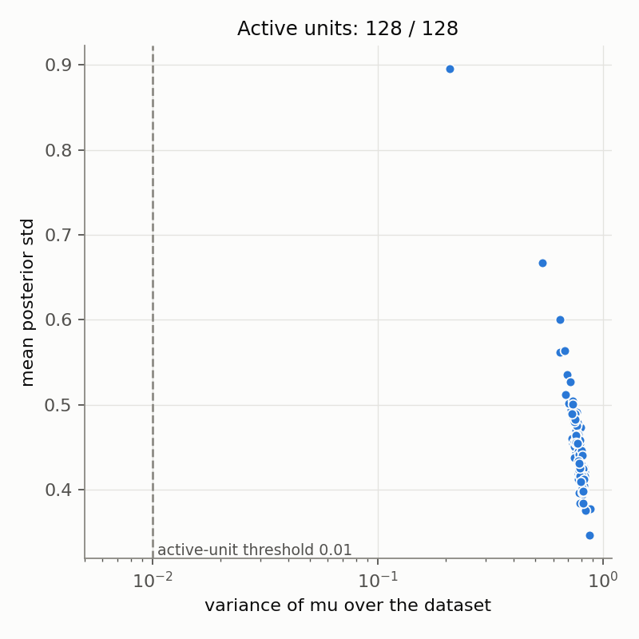

**図2** 降順に並べた次元ごとのKL (左)，**図3** $` \boldsymbol\mu `$ の分散と平均標準偏差の散布図 (右)

標準偏差の大きい次元ほど，デコーダの重みの列ノルムが小さい．次元ごとの平均標準偏差と列ノルムの相関係数は −0.95 である．標準偏差が最大の次元107は列ノルムが最小 (0.360) であり，標準偏差が最小の次元97は列ノルムが最大 (1.795) である．この結果，$` \alpha = 1 `$ のときに各次元が出力を動かす量 (平均標準偏差 × 列ノルム) は 0.32〜0.70 の範囲に収まり，次元間でほぼ均等である．図4にデコーダの重みの特異値を示す．横軸は特異値の順位，縦軸は特異値である．

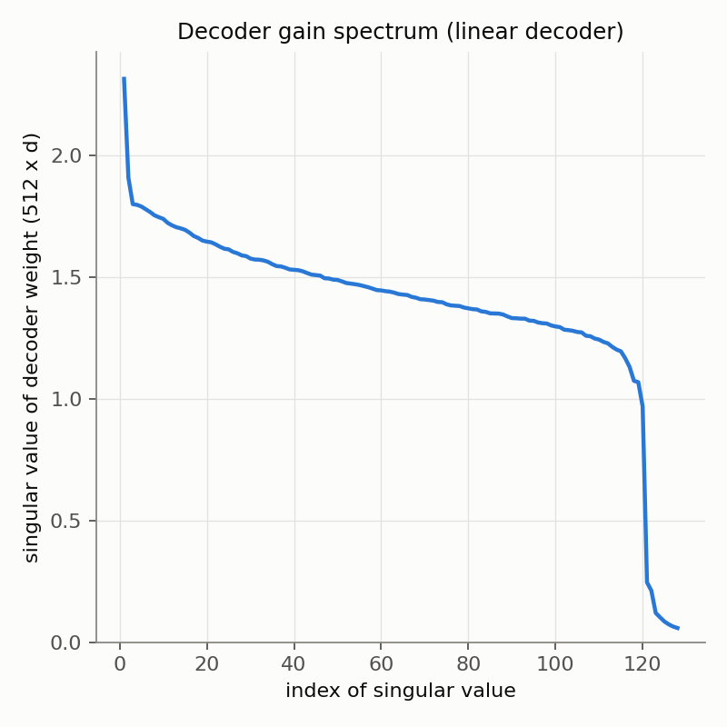

**図4** デコーダの重み行列の特異値

## 5. 実験2：潜在空間での移動量と出力の変化

### 5.1 比較基準

**表4** サンプリングに依存しない比較基準 (画像ごとの値の分布)

| 量 | 平均 | 5% | 中央値 | 95% |
| :---: | :---: | :---: | :---: | :---: |
| $` \| \boldsymbol\mu \| `$ | 9.86 | 7.95 | 9.85 | 11.81 |
| $` \boldsymbol\mu `$ 空間での最近傍の他画像までの距離 | 8.61 | 2.50 | 9.46 | 11.36 |
| $` \boldsymbol\mu `$ 空間でのランダムな他画像までの距離 | 13.97 | 11.80 | 13.94 | 16.22 |
| $` \| \mathbf v \| `$ | 22.42 | 18.44 | 22.41 | 26.42 |
| $` \| \mathbf v_0 \| `$ | 14.96 | 11.77 | 14.79 | 18.83 |
| $` \cos(\mathbf v_0, \mathbf v) `$ | 0.816 | 0.732 | 0.816 | 0.905 |
| $` \cos(\mathbf v, \text{最近傍の他画像の} \mathbf v) `$ | 0.506 | 0.285 | 0.399 | 0.964 |
| $` \cos(\mathbf v, \text{ランダムな他画像の} \mathbf v) `$ | 0.004 | −0.110 | 0.002 | 0.124 |
| $` \cos(\mathbf v_0, \text{最近傍の他画像の} \mathbf v_0) `$ | 0.564 | 0.366 | 0.466 | 0.969 |
| $` \alpha = 1 `$ のときの出力の移動量の二乗平均平方根 $` \sigma_{\mathrm{out}} `$ | 7.14 | 6.96 | 7.14 | 7.32 |

$` \alpha = 0 `$ の時点で $` \cos(\mathbf v_0, \mathbf v) `$ は 0.816 であり，再構成の段階で類似度は既に 1 から下がっている．また $` \| \mathbf v_0 \| `$ は $` \| \mathbf v \| `$ の約 2/3 に縮んでいる．

### 5.2 α ごとの移動量と類似度

**表5** $` \alpha `$ ごとの潜在空間での移動量 ($` d_{\mathrm{latent}} = \| \alpha \, \mathbf s \odot \mathbf z \| `$)

| $` \alpha `$ | $` d_{\mathrm{latent}} `$ 平均 (5%〜95%) | $` d_{\mathrm{latent}} / \| \boldsymbol\mu \| `$ 平均 | $` d_{\mathrm{latent}} `$ / 最近傍距離 中央値 | 最近傍距離を超えたサンプルの割合 | ランダムな他画像までの距離を超えた割合 |
| :---: | :---: | :---: | :---: | :---: | :---: |
| 0 | 0 | 0 | 0 | 0 | 0 |
| 1 | 5.13 (4.58〜5.71) | 0.529 | 0.546 | 0.108 | 0.000 |
| 1.25 | 6.42 (5.72〜7.14) | 0.661 | 0.683 | 0.168 | 0.000 |
| 1.5 | 7.70 (6.86〜8.58) | 0.793 | 0.819 | 0.254 | 0.000 |
| 2 | 10.27 (9.15〜11.43) | 1.057 | 1.092 | 0.716 | 0.007 |
| 3 | 15.40 (13.73〜17.15) | 1.586 | 1.638 | 1.000 | 0.799 |
| 5 | 25.67 (22.89〜28.57) | 2.643 | 2.731 | 1.000 | 1.000 |

**表6** $` \alpha `$ ごとの出力側の類似度と移動量

| $` \alpha `$ | $` \cos(\tilde{\mathbf v}, \mathbf v) `$ 平均 (5%〜95%) | 閉形式による予測 | $` \cos(\tilde{\mathbf v}, \mathbf v_0) `$ 平均 | 出力の移動量 $` \| \tilde{\mathbf v} - \mathbf v_0 \| `$ 平均 | 最近傍の他画像との類似度を下回った割合 | ランダムな他画像の95%点 (0.124) を下回った割合 |
| :---: | :---: | :---: | :---: | :---: | :---: | :---: |
| 0 | 0.816 (0.732〜0.905) | 0.816 | 1.000 | 0 | 0.115 | 0.00 |
| 1 | 0.735 (0.633〜0.843) | 0.734 | 0.899 | 7.13 | 0.180 | 0.00 |
| 1.25 | 0.699 (0.589〜0.815) | 0.698 | 0.854 | 8.91 | 0.212 | 0.00 |
| 1.5 | 0.661 (0.545〜0.784) | 0.661 | 0.808 | 10.69 | 0.244 | 0.00 |
| 2 | 0.588 (0.462〜0.721) | 0.588 | 0.718 | 14.25 | 0.302 | 0.00 |
| 3 | 0.466 (0.332〜0.608) | 0.466 | 0.569 | 21.38 | 0.416 | 0.00 |
| 5 | 0.315 (0.181〜0.456) | 0.316 | 0.384 | 35.63 | 0.817 | 0.01 |

$` \alpha = 2 `$ のとき $` \cos(\tilde{\mathbf v}, \mathbf v) `$ の平均は 0.588 であり，問題として挙げられていた値 (平均 0.57) とほぼ一致する．3つのシード間での平均値の標準偏差は 0.0002 以下であり，結果はシードに依存しない．VAEの学習用の画像 (20,752 枚) と検証用の画像 (2,373 枚) の差も小さく，$` \alpha = 2 `$ で 0.589 と 0.583 である．表6の $` \alpha = 0 `$ で最近傍を下回る割合が 0.115 あるのは，2.5節で述べた重複画像のためである．

図5に $` \alpha `$ に対する移動量を示す．横軸は $` \alpha `$，縦軸は潜在空間での距離であり，実線が $` d_{\mathrm{latent}} `$ の平均，帯が 5%〜95% の範囲，水平線が比較基準である．$` d_{\mathrm{latent}} `$ は $` \alpha `$ に比例し，$` \alpha \approx 1.9 `$ で最近傍距離の中央値と $` \| \boldsymbol\mu \| `$ の中央値を超え，$` \alpha \approx 2.7 `$ でランダムな他画像までの距離の中央値を超える．

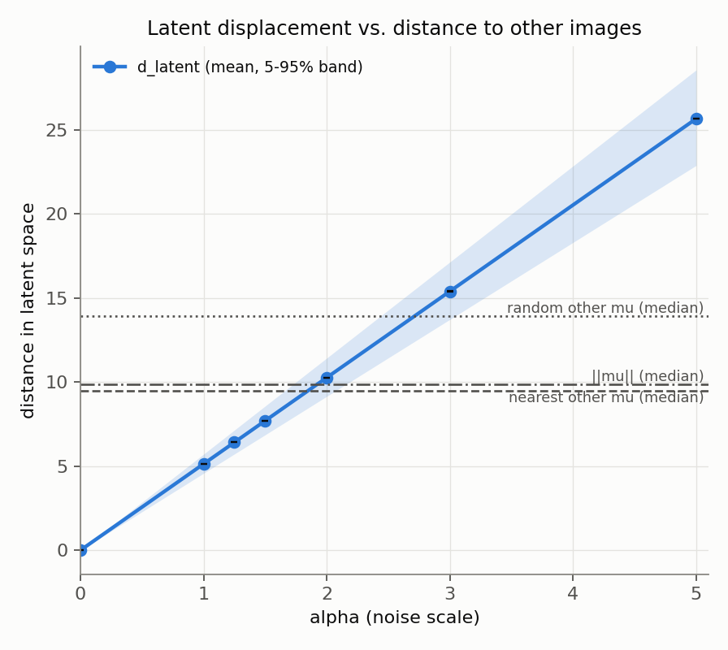

**図5** $` \alpha `$ に対する潜在空間での移動量と，他画像までの距離の比較

図6に $` \alpha `$ に対する類似度を示す．横軸は $` \alpha `$，縦軸はコサイン類似度であり，実線が平均，帯が 5%〜95% の範囲，黒の破線が5.3節の閉形式による予測，水平線が比較基準である．類似度は $` \alpha `$ に対して緩やかにしか下がらず，$` \alpha = 5 `$ でも平均 0.315 であり，ランダムな他画像との類似度の水準 (95%点で 0.124) には届かない．

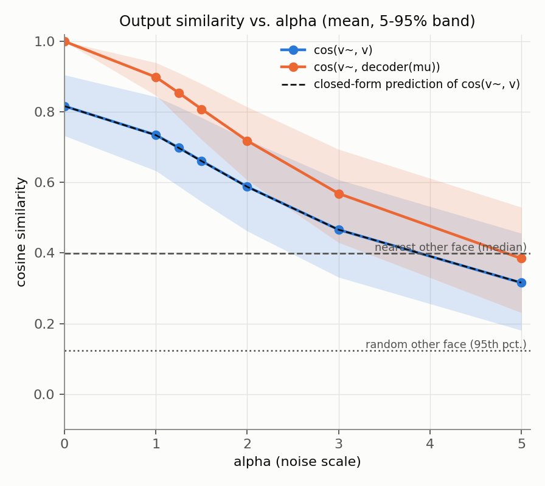

**図6** $` \alpha `$ に対する $` \cos(\tilde{\mathbf v}, \mathbf v) `$ と $` \cos(\tilde{\mathbf v}, \mathbf v_0) `$

### 5.3 デコーダの感度と閉形式

図7に移動量と類似度の散布図を，図8に潜在空間の移動量と出力の移動量の散布図を示す．どちらも横軸は $` d_{\mathrm{latent}} `$，点の色の濃さが $` \alpha `$ である．図8から，出力の移動量は潜在空間の移動量にほぼ比例する．その比の平均は全ての $` \alpha `$ で **1.389** であり，デコーダは潜在空間の移動を縮めるのではなく拡大して出力に伝えている．

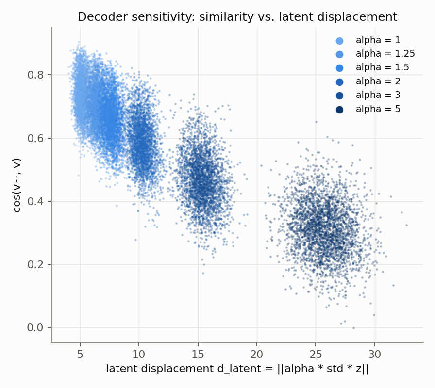 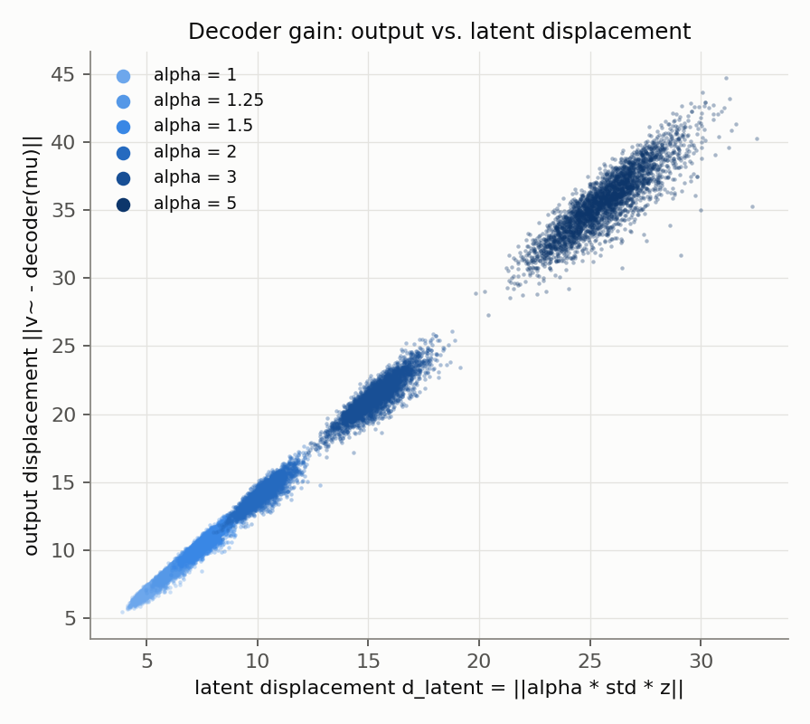

**図7** $` d_{\mathrm{latent}} `$ と $` \cos(\tilde{\mathbf v}, \mathbf v) `$ の散布図 (左)，**図8** $` d_{\mathrm{latent}} `$ と出力の移動量の散布図 (右)

デコーダが線形 ($` \mathrm{decoder}(\mathbf f) = \mathbf W \mathbf f + \mathbf b `$) であるため，出力は $` \tilde{\mathbf v} = \mathbf v_0 + \alpha \mathbf W (\mathbf s \odot \mathbf z) `$ と分解できる．第2項は平均 0 のランダムなベクトルであり，高次元では $` \mathbf v_0 `$ および $` \mathbf v `$ とほぼ直交する．その二乗ノルムの期待値は $` \alpha^2 \sigma_{\mathrm{out}}^2 `$，$` \sigma_{\mathrm{out}}^2 = \sum_{j} s_j^2 \| \mathbf w_j \|^2 `$ である．ここで $` \mathbf w_j `$ は $` \mathbf W `$ の第 $` j `$ 列である．以上から(2)が得られる．

```math
\cos(\tilde{\mathbf v}, \mathbf v) \approx \frac{\cos(\mathbf v_0, \mathbf v)}{\sqrt{1 + \alpha^2 \rho^2}} ,
\qquad
\rho = \frac{\sigma_{\mathrm{out}}}{\| \mathbf v_0 \|}
\tag{2}
```

$` \rho `$ は $` \alpha = 1 `$ のときの出力空間でのノイズと信号の比であり，平均的には $` 7.14 / 14.96 \approx 0.48 `$ である．表6のとおり，(2)による予測は実測と小数第3位まで一致する．すなわち，観測された類似度の挙動は(2)で説明し尽くされる．(2)は次のことを意味する．

- ランダムな方向への移動は元の成分 $` \mathbf v_0 `$ を減らさない．類似度は「直交するノイズを足したことによる希釈」でしか下がらず，その下がり方は $` 1 / \sqrt{1 + \alpha^2 \rho^2} `$ と緩やかである．信号と同じ大きさのノイズを足しても ($` \alpha \rho = 1 `$，$` \alpha \approx 2.1 `$)，類似度は $` 1/\sqrt{2} `$ 倍にしかならない．
- この性質のため，潜在空間で他画像と同じ距離だけ動いても，他画像と同程度には離れない．最近傍の他画像の $` \boldsymbol\mu `$ へ移った場合の類似度 $` \cos(\mathbf v_0, \text{最近傍の} \mathbf v_0) `$ は中央値 0.466 であるのに対し，それより長い距離をランダムな方向へ動く $` \alpha = 2 `$ ($` d_{\mathrm{latent}} = 10.27 `$，最近傍距離の中央値は 9.46) では $` \cos(\tilde{\mathbf v}, \mathbf v_0) `$ は 0.718 に留まる．他画像への移動は $` \boldsymbol\mu `$ 自体を置き換えるが，ランダムな移動は $` \boldsymbol\mu `$ を残したまま成分を足すだけだからである．

(2)を $` \alpha `$ について解くと，目標の類似度に必要な $` \alpha `$ を画像ごとに見積もることができる．表7はその見積もりであり，実測値ではなく(2)による予測である．

**表7** 目標の $` \cos(\tilde{\mathbf v}, \mathbf v) `$ に必要な $` \alpha `$ の見積もり ((2)による予測)

| 目標の類似度 | 必要な $` \alpha `$ 平均 | 5%〜95% | 対応する $` d_{\mathrm{latent}} `$ 平均 |
| :---: | :---: | :---: | :---: |
| 0.6 | 1.95 | 1.21〜2.91 | 10.0 |
| 0.5 | 2.73 | 1.84〜3.91 | 14.0 |
| 0.4 | 3.76 | 2.62〜5.26 | 19.3 |
| 0.3 | 5.34 | 3.80〜7.39 | 27.5 |
| 0.2 | 8.35 | 5.99〜11.47 | 42.9 |
| 0.1 | 17.09 | 12.32〜23.39 | 87.9 |

最近傍の他画像との類似度の中央値 (0.40) まで下げるには $` \alpha \approx 3.8 `$，0.3 まで下げるには $` \alpha \approx 5.3 `$ が必要であり，実測の $` \alpha = 5 `$ での平均 0.315 と整合する．必要な $` \alpha `$ は画像によって2倍以上異なる．

**表8** $` \cos(\tilde{\mathbf v}, \mathbf v) `$ のばらつきの内訳

| $` \alpha `$ | 同一画像内の標準偏差 (平均) | 画像間の標準偏差 | $` K = 10 `$ 本中の最小値の平均 |
| :---: | :---: | :---: | :---: |
| 1 | 0.012 | 0.062 | 0.715 |
| 2 | 0.031 | 0.072 | 0.536 |
| 3 | 0.047 | 0.070 | 0.389 |
| 5 | 0.062 | 0.058 | 0.214 |

同じ画像に対して $` \mathbf z `$ を引き直したときの類似度のばらつきは，$` \alpha = 2 `$ で標準偏差 0.031 と小さい．類似度のばらつきの大半は画像間の差，すなわち $` \cos(\mathbf v_0, \mathbf v) `$ と $` \| \mathbf v_0 \| `$ の差に由来する．

## 6. 実験3：半径を固定したサンプリングとの比較

同じ $` \mathbf u \sim \mathcal N(\mathbf 0, \mathbf I) `$ から，ガウスサンプル $` \mathbf z = \mathbf u `$ と，半径を固定したサンプル $` \mathbf z = r \sqrt{d} \, \mathbf u / \| \mathbf u \| `$ を作って比較した．$` r `$ は半径の倍率であり，$` r \in \{0.5, 1, 1.5, 2\} `$ とした．$` \mathbf u `$ は全ての $` \alpha `$ で共有した．

ガウスサンプルのノルムの実測値は，平均 11.291，標準偏差 0.707，最小 8.35，最大 14.54 であり，$` \sqrt{d} = 11.314 `$ に対する変動係数は 6.3% である．ガウスサンプルは既に半径 $` \sqrt{d} `$ の殻に集中している．図9にその分布を示す．横軸は $` \| \mathbf z \| `$，縦軸は度数である．

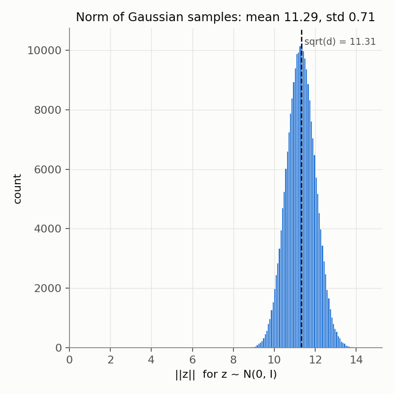

**図9** ガウスサンプルのノルムの分布

**表9** ガウスサンプリングと半径 $` \sqrt{d} `$ に固定したサンプリングの比較 (画像ごとの平均を対応させた $` N = 23{,}125 `$ 組の検定)

| $` \alpha `$ | ガウス 平均 | 半径固定 平均 | 差の平均 (95%信頼区間) | 対応のあるt検定 $` p `$ | Wilcoxon検定 $` p `$ | 効果量 $` d_z `$ | 効果量 $` d_{\mathrm{av}} `$ |
| :---: | :---: | :---: | :---: | :---: | :---: | :---: | :---: |
| 1 | 0.7347 | 0.7345 | 0.00017 (0.00013〜0.00021) | $` 4.5 \times 10^{-20} `$ | $` 3.4 \times 10^{-19} `$ | 0.060 | 0.003 |
| 1.25 | 0.6986 | 0.6983 | 0.00031 (0.00026〜0.00036) | $` 2.3 \times 10^{-36} `$ | $` 5.7 \times 10^{-34} `$ | 0.083 | 0.005 |
| 1.5 | 0.6612 | 0.6607 | 0.00047 (0.00042〜0.00053) | $` 3.8 \times 10^{-57} `$ | $` 9.1 \times 10^{-53} `$ | 0.105 | 0.007 |
| 2 | 0.5881 | 0.5873 | 0.00081 (0.00074〜0.00088) | $` 5.9 \times 10^{-106} `$ | $` 7.6 \times 10^{-97} `$ | 0.145 | 0.011 |
| 3 | 0.4662 | 0.4650 | 0.00124 (0.00116〜0.00132) | $` 5.7 \times 10^{-199} `$ | $` 6.6 \times 10^{-181} `$ | 0.200 | 0.018 |
| 5 | 0.3156 | 0.3143 | 0.00134 (0.00127〜0.00141) | $` 1.4 \times 10^{-307} `$ | $` 2.3 \times 10^{-279} `$ | 0.250 | 0.023 |

ここで $` d_z `$ は差の平均を差の標準偏差で割った効果量，$` d_{\mathrm{av}} `$ は差の平均を2群の標準偏差の平均で割った効果量である．$` \alpha = 0 `$ では両者は完全に一致するため検定の対象外である．サンプル数が大きいため差は統計的に有意であるが，**差の大きさは類似度で最大 0.0013 であり，実用上の意味を持たない．** 類似度そのもののばらつき (標準偏差 0.06〜0.08) に対する効果量 $` d_{\mathrm{av}} `$ は最大でも 0.023 である．$` d_z `$ がこれより大きいのは，同じ方向 $` \mathbf u `$ を共有しているために差のばらつきが極めて小さいからであり，差が大きいことを意味しない．なお，差の符号は正であり，半径を固定した方がわずかに類似度が低い．これは，ノルムが揺らぐガウスサンプルでは，(2)の $` \alpha `$ に関する下に凸な性質により平均の類似度がわずかに高くなるためと解釈できる．3つのシード間で，差の平均の標準偏差は 0.00001 であった．

図10に両者の比較を，図11に差の平均を示す．図10の横軸は $` \alpha `$，縦軸は $` \cos(\tilde{\mathbf v}, \mathbf v) `$ の平均であり，2本の線は重なって区別できない．図11の横軸は $` \alpha `$，縦軸は差の平均であり，縦軸の目盛りが $` 10^{-3} `$ の桁であることに注意されたい．

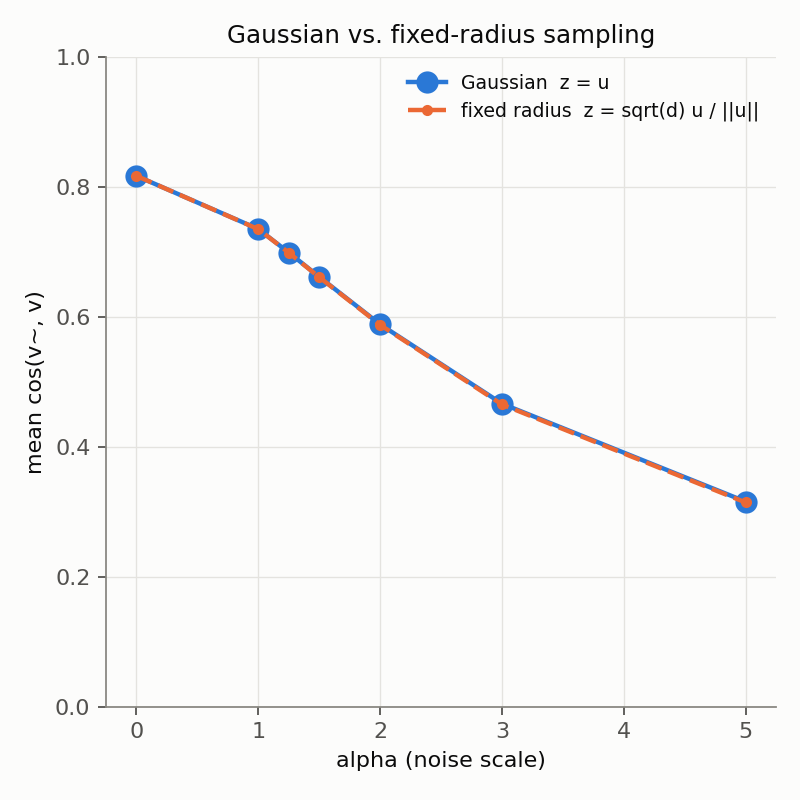 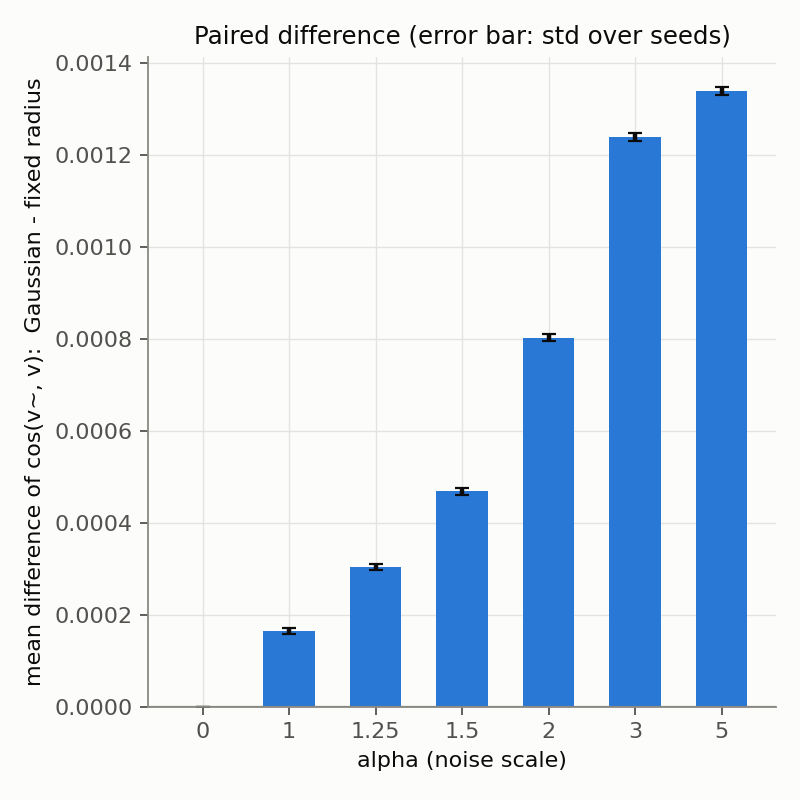

**図10** ガウスサンプリングと半径固定サンプリングの比較 (左)，**図11** 両者の差の平均 (右，誤差棒はシード間の標準偏差)

半径の倍率 $` r `$ を変えた結果を表10に示す．$` (\alpha, r) `$ の結果は $` (\alpha r, 1) `$ の結果と一致する．$` \alpha r `$ が別の $` \alpha `$ の設定値と重なる6組について，サンプルごとの類似度の差の最大絶対値は $` 2.4 \times 10^{-7} `$ 以下であり，単精度の丸め誤差の範囲であった．半径の変更は $` \alpha `$ のスケーリングと等価である．図12の横軸は実効的な $` \alpha `$ である $` \alpha r `$，縦軸は類似度の平均であり，全ての設定が1本の曲線上に並ぶ．

**表10** 半径の倍率 $` r `$ ごとの $` \cos(\tilde{\mathbf v}, \mathbf v) `$ の平均

| $` \alpha `$ | ガウス | $` r = 0.5 `$ | $` r = 1 `$ | $` r = 1.5 `$ | $` r = 2 `$ |
| :---: | :---: | :---: | :---: | :---: | :---: |
| 1 | 0.7347 | 0.7933 | 0.7345 | 0.6607 | 0.5873 |
| 1.25 | 0.6986 | 0.7811 | 0.6983 | 0.6051 | 0.5215 |
| 1.5 | 0.6612 | 0.7671 | 0.6607 | 0.5533 | 0.4650 |
| 2 | 0.5881 | 0.7345 | 0.5873 | 0.4650 | 0.3771 |
| 3 | 0.4662 | 0.6607 | 0.4650 | 0.3431 | 0.2682 |
| 5 | 0.3156 | 0.5215 | 0.3143 | 0.2190 | 0.1670 |

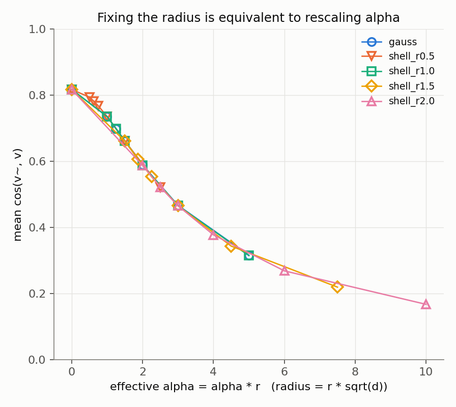

**図12** 実効的な $` \alpha `$ に対する $` \cos(\tilde{\mathbf v}, \mathbf v) `$ の平均

## 7. 仮説の検証結果

仮説は「サンプリングの形ではなく，潜在空間での移動量やデコーダの感度が問題である」というものであった．

**表11** 仮説の各要素に対する判定

| 原因の候補 | 判定 | 根拠 |
| :---: | :---: | :--- |
| 分布の形 | 原因ではない (仮説を支持) | ガウスと半径固定の差は類似度で最大 0.0013，効果量 $` d_{\mathrm{av}} `$ は最大 0.023．半径の変更は $` \alpha `$ のスケーリングと等価 |
| 移動量の小ささ | 主因である (仮説を支持，ただし補足が必要) | 標準偏差が平均 0.45 と小さく，$` \alpha = 1 `$ での出力のノイズと信号の比は 0.48 に過ぎない．類似度は(2)に従い，この比だけで決まる |
| デコーダの鈍感さ | 原因ではない (仮説を支持しない) | デコーダは線形で，移動を 1.39 倍に拡大する．不活性な次元は 0．標準偏差の大きい次元ほど列ノルムが小さく，次元ごとの寄与はほぼ均等 |

「移動量の小ささ」については補足が必要である．潜在空間での距離だけを見れば，$` \alpha = 2 `$ の移動量は最近傍の他画像までの距離を超えており，小さいとは言えない．不足しているのは，元の成分に対するノイズの相対的な大きさである．現在のサンプリングは元の $` \boldsymbol\mu `$ を保持したまま直交するノイズを足す構造であるため，類似度を 0.3 以下に下げるには $` \alpha > 5 `$ が必要になる．問題は「どれだけ動くか」だけでなく「元の成分を残したまま動いていること」にある．

## 8. 次に試すべきことの候補

以下はいずれも未実施であり，効果は検証していない．

1. **人ごとの $` \alpha `$ の調整．** (2)を用いると，目標の類似度に必要な $` \alpha `$ を，サンプリングせずに画像ごとに閉形式で求められる．必要な $` \alpha `$ は画像によって2倍以上異なる (表7) ため，一律の $` \alpha `$ より目標値への的中率が高いと見込まれる．実装が最も軽く，最初に試す候補である．
2. **元の成分を減衰させるサンプリング．** $` \mathbf f = \gamma \boldsymbol\mu + \alpha \, \mathbf s \odot \mathbf z `$ ($` 0 \le \gamma < 1 `$) のように $` \boldsymbol\mu `$ を縮める，あるいは他画像の $` \boldsymbol\mu `$ の方向へ移動する方法である．(2)の分子を直接小さくできるため，ノイズを増やすより小さな移動で類似度を下げられる可能性がある．一方で，性別や年齢などの属性が $` \boldsymbol\mu `$ に含まれているため，属性の保持との両立を確認する必要がある．
3. **目標の類似度に達するまでの棄却サンプリング．** 同一画像内の類似度の標準偏差は $` \alpha = 2 `$ で 0.031 であり，10本中の最小値を選んでも平均 0.588 が 0.536 になる程度である (表8)．単独では効果が限定的であり，1 や 2 と組み合わせて最後の微調整に使うのが妥当と考えられる．
4. **標準偏差の大きい次元を優先して動かす方法．** 効果は小さいと予想される．標準偏差の大きい次元はデコーダの列ノルムが小さく，出力への寄与が次元間でほぼ均等だからである (4章)．出力を効率よく動かすことが目的であれば，標準偏差ではなくデコーダの重みの特異ベクトルに沿って動かす方が理にかなう．
5. **GHOSTを通した評価．** 本診断はベクトル空間のみで行った．$` \tilde{\mathbf v} `$ のノルムは $` \alpha `$ とともに増加し ($` \alpha = 5 `$ で $` \| \tilde{\mathbf v} - \mathbf v_0 \| `$ の平均は 35.6)，実際のArcFaceベクトルのノルム (平均 22.4) から外れる．生成画像からArcFaceを再抽出した類似度と属性の保持率が，ベクトル空間での結果とどう対応するかを確認する必要がある．

## 9. 未解決の論点

- 顔検出に成功した枚数 (23,125) と，想定されていた枚数 (23,088) の差 37 枚の由来は特定できていない．リポジトリに同梱された抽出済みの顔ベクトルは 23,125 行であり，今回の抽出結果と一致する．
- UTKFaceには人物のラベルが無いため，「他人」の基準は「他の画像」で代用している．同一人物の別画像や重複画像が含まれるため，最近傍に関する基準は真の他人との距離より近い側に偏っている可能性がある．
- VAEの学習用と検証用の分割には重複画像がまたがっている．検証用の顔ベクトルは 2,313 行であるが，これと一致する画像は 2,373 枚あった．
- $` \alpha = 0 `$ での $` \cos(\mathbf v_0, \mathbf v) = 0.816 `$ という再構成の限界と，$` \| \mathbf v_0 \| `$ の縮小が，GHOSTの出力に与える影響は未確認である．
- (2)はデコーダが線形であることに依存する．デコーダを非線形にしたVAEでは成り立つとは限らない．

## 10. 実行環境に関する注意

既存のconda環境 `identity-anonymizer` を用いた．この環境では `mxnet-cu112` が読み込めない (CUDA 11.2 のランタイムが存在しない) ため，既存の `load_ghost_models` は実行できなかった．ArcFaceの抽出に必要なのは顔検出器とArcFaceのみであるため，診断用のスクリプトではこの2つだけを読み込み，前処理は既存実装と同一にした．また，`insightface==0.2.1` と `onnxruntime-gpu==1.14.0` の組み合わせでは `InferenceSession` の生成時に例外が発生するため，スクリプトのプロセス内に限って providers の既定値を補っている．顔検出器はCPUで動作した．抽出結果が同梱の顔ベクトルと一致することは2.5節のとおり確認済みである．
