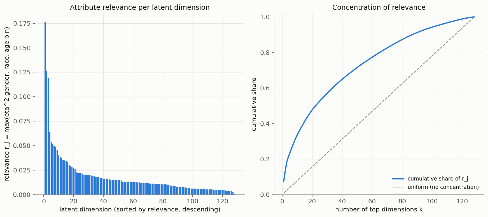
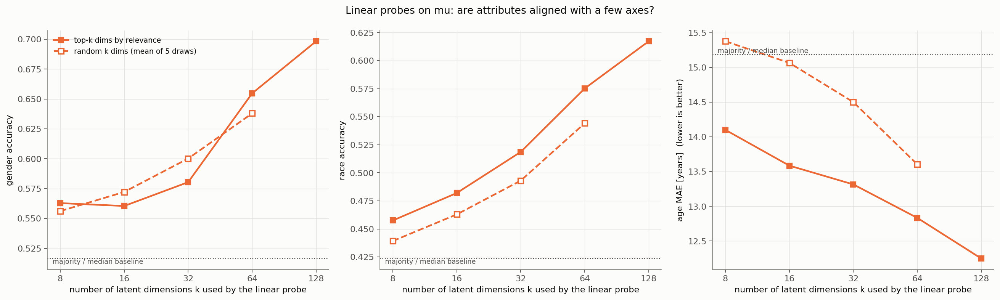
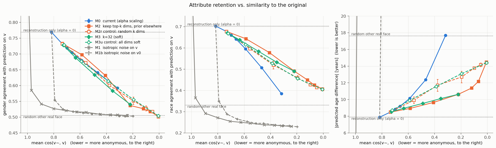
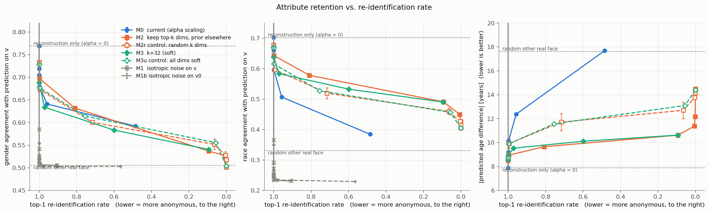
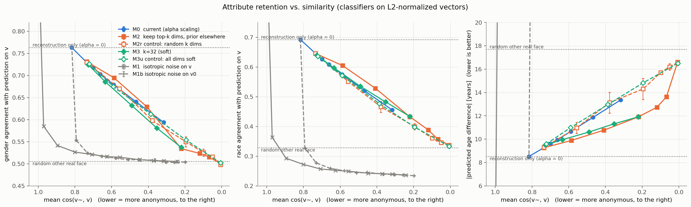
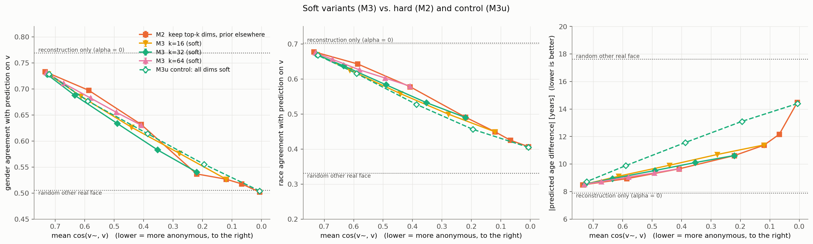
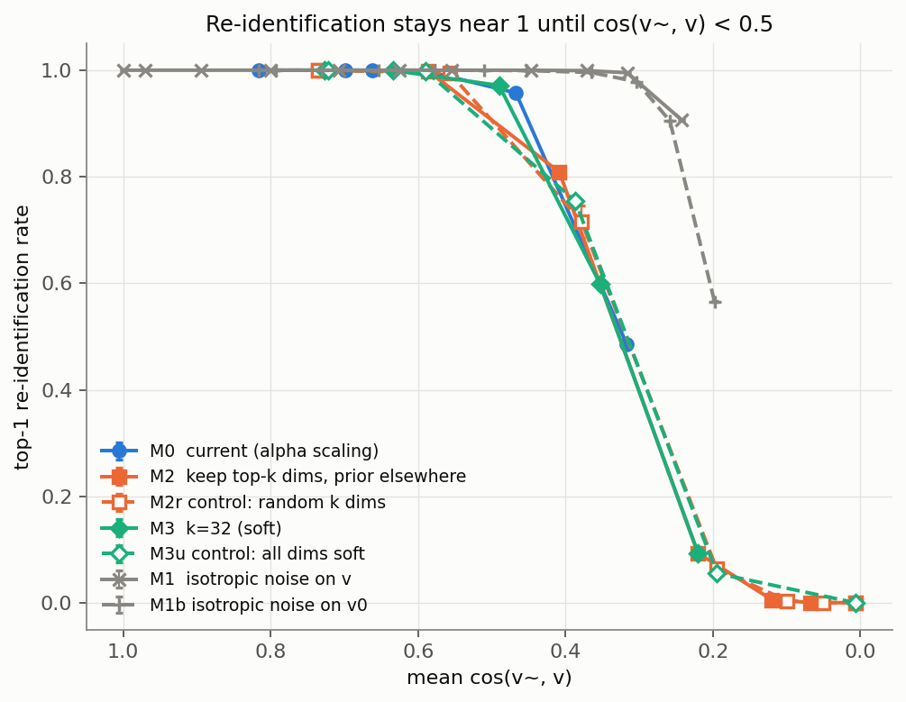
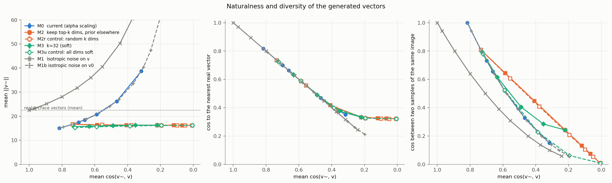
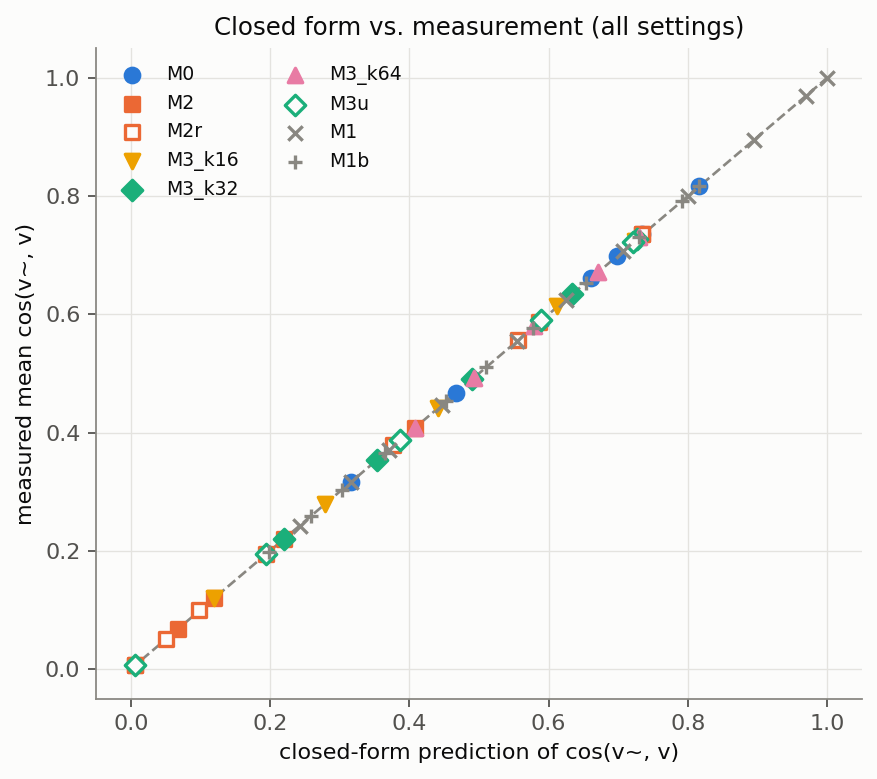

# Report 002：属性次元を保持し，他の次元を事前分布から取るサンプリングの検証

## 1. 概要

学習済みの変分オートエンコーダ (Variational Autoencoder，VAE) を再学習せずに，「属性を担う潜在次元は事後分布から，それ以外の次元は事前分布 $` \mathcal N(0, 1) `$ から取る」サンプリングが，現行の $` \alpha `$ スケーリングより少ない属性の劣化で類似度を下げられるかを，ベクトル空間のみで検証した．結論は次のとおりである．

1. **仮説は弱くしか支持されなかった．** 同じ類似度で比べると，提案方式 M2 は対照 M2r に対して性別の一致率で 1.4〜1.9 ポイント，人種の一致率で 3.0〜4.5 ポイント，年齢の予測差で 0.7〜1.8 歳だけ良い．差の符号は3つのシードで一貫しているが，大きさは小さい．ソフトな提案方式 M3 は，対照 M3u に対して性別では改善が無い．
2. **次元を選ぶ案の前提が成り立っていない．** 属性は少数の潜在次元に揃っていない．属性関連度の上位32次元だけを使った線形分類器は，性別の正解率が 0.580 であり，全128次元の 0.698 を大きく下回り，ランダムに選んだ32次元の 0.600 と同程度である．
3. **属性はサンプリング以前に，VAEの再構成の段階で大きく失われている．** 実際の顔ベクトル $` \mathbf v `$ に対する分類器の正解率は性別 0.805，人種 0.738 であるが，$` \alpha = 0 `$ の再構成 $` \mathbf v_0 `$ では 0.697 と 0.598 に下がる．どの方式もこの水準が上限になる．
4. **匿名性と属性の保持は，どの方式でも両立していない．** 再識別率は $` \cos(\tilde{\mathbf v}, \mathbf v) `$ の平均が 0.5 を下回るまでほぼ 1 のままである．再識別率が 0.1 まで下がる設定では，性別の一致率は 0.54〜0.56 であり，偶然の水準 0.505 に近い．

中断して報告する条件のうち，次の3点が該当した．実験Bは実行済みであり，以下の結果はこれらを前提として読む必要がある．

- 実験Aで，上位32次元での分類精度が全次元での精度より大きく劣った．
- M3 と M3u の差は性別ではほとんど無く，M2 と M2r の差も小さかった．
- 想定外の挙動として，評価用の線形分類器が等方的なノイズに極端に弱く，比較対象 M1 と M1b の属性の評価が意味を持たないことが分かった (5.4節)．

## 2. 確認した事項

### 2.1 GHOSTによるソースの埋め込みの正規化

**GHOSTはソースの埋め込みをL2正規化していない．** 該当箇所を表1に示す．推論時は `faceshifter_batch` が受け取った埋め込みをそのまま生成器に渡し，生成器の内部でも正規化は行われない．学習時も正規化の行はコメントアウトされている．正規化が使われているのは，動画中の対象人物を追跡するための類似度の計算だけである．

**表1** ソースの埋め込みの扱いに関するコードの場所

| 場所 | 内容 |
| :--- | :--- |
| `src/identity_anonymizer/faceswap/pipeline.py` 116〜122行 | `source_embed = self.anonymizer.anonymize(...)` の結果を `faceshifter_batch(source_embed.half(), ...)` に渡す．正規化なし |
| `third_party/ghost/utils/inference/faceshifter_run.py` | `G(target, source_emb)` を呼ぶのみ．正規化なし |
| `third_party/ghost/network/AEI_Net.py` 122〜131行，`AADLayer.py` 28〜29行 | `z_id` を `up1` と各AAD層の全結合層 `fc1`，`fc2` に直接入力する．正規化なし |
| `third_party/ghost/utils/training/image_processing.py` 73行 | `# embeds = F.normalize(embeds, p=2, dim=1)` とコメントアウトされている |
| `third_party/ghost/train.py` 60〜70行 | `embed = netArc(...)` をそのまま `G(Xt, embed)` に渡す．正規化なし |
| `third_party/ghost/utils/inference/video_processing.py` 129，143行 | `F.normalize` を使うが，対象人物の照合用であり，生成器への入力ではない |

この結果に従い，評価は正規化しない生のベクトルで行った．線形の分類器はノルムの影響を受けるため，L2正規化したベクトルで学習・評価した分類器の結果も参考として併記する．

### 2.2 ラベルのパース

ファイル名 `[age]_[gender]_[race]_[date].jpg` からラベルを取得した．形式が崩れたファイル名は，拡張子が `.jpg` の 24,106 枚中 **5 枚 (0.02%)** であった．5 枚とも顔ベクトルの抽出には成功しており，属性の評価からは除外し，再識別の探索対象には残した．崩れ方は，人種の欠落が3枚 (`39_1_20170116174525125.jpg`，`61_1_20170109142408075.jpg`，`61_3_20170109150557335.jpg`)，性別の欠落が1枚 (`53__0_20170116184028385.jpg`)，拡張子の前の空白が1枚である．ラベルを取得できた画像は 23,120 枚で，性別は男性 11,976・女性 11,144，人種は 0 から順に 9,835・4,362・3,430・3,897・1,596 である．

### 2.3 重複グループとデータ分割

ArcFace空間でコサイン類似度が 0.9 以上の組を辺とするグラフの連結成分を重複グループとした．完全に一致する画像はこの条件に含まれる．グループ数は 22,155 であり，2枚以上を含むグループは 878 組 (計 1,848 枚，最大5枚) である．重複グループを単位として 8:2 に分割し，**学習用 18,506 枚，評価用 4,614 枚** を得た．両側にまたがるグループは 0 である．分割は乱数シード 0 で固定し，乱数シード 0，1，2 はサンプリングのノイズと M2r の次元の選択に用いた．

## 3. 実験A：潜在次元ごとの属性関連度

全 23,120 枚の $` \boldsymbol\mu `$ について，次元ごとに性別・人種・年代ビンに対する相関比 $` \eta^2 `$ と，年齢とのSpearmanの順位相関を計算した．総合スコア $` r_j `$ は3つの $` \eta^2 `$ の最大値である．

**表2** 属性関連度の集計 (128次元)

| 指標 | 最小 | 中央値 | 最大 |
| :---: | :---: | :---: | :---: |
| $` \eta^2 `$ (性別) | 0.0000 | 0.0009 | 0.0145 |
| $` \eta^2 `$ (人種) | 0.0001 | 0.0070 | 0.0482 |
| $` \eta^2 `$ (年代ビン) | 0.0008 | 0.0094 | 0.1763 |
| 年齢とのSpearman相関 | −0.222 | 0.002 | 0.262 |
| $` r_j `$ | 0.0010 | 0.0123 | 0.1763 |

$` r_j `$ の累積シェアは，上位 8・16・32・64 次元で 30%・43%・59%・80% である．均等な場合の 6%・13%・25%・50% と比べれば偏っているが，絶対値が小さい．最も関連の強い次元でも，年代で説明できる分散は 18% であり，**性別については，どの次元も分散の 1.5% 以下しか説明しない．** また，上位32次元のうち27次元は年代の $` \eta^2 `$ が，5次元は人種の $` \eta^2 `$ が $` r_j `$ を決めており，性別の $` \eta^2 `$ が最大になる次元は128次元全体でも2つしかない．上位の次元は実質的に「年齢に関連する次元」である．図1の左は $` r_j `$ を降順に並べた棒グラフであり，横軸が順位，縦軸が $` r_j `$ である．右は累積シェアであり，横軸が上位の次元数 $` k `$，縦軸が累積シェア，破線が均等な場合である．



**図1** 属性関連度 $` r_j `$ の降順の棒グラフ (左) と累積シェア (右)

軸に揃っているかを確かめるため，$` \boldsymbol\mu `$ の一部の次元だけを入力とする線形分類器を学習用データで学習し，評価用データで精度を測った．次元の順位は学習用データだけで計算した関連度から決めた．全画像で計算した順位との順位相関は 0.994 であり，上位32次元のうち31次元が一致する．

**表3** $` \boldsymbol\mu `$ の一部の次元を使った線形分類器の評価用データでの精度

| 使う次元 | 性別の正解率 | 人種の正解率 | 年齢のMAE [歳] |
| :---: | :---: | :---: | :---: |
| 上位 8 / ランダム 8 | 0.563 / 0.556 | 0.458 / 0.439 | 14.10 / 15.38 |
| 上位 16 / ランダム 16 | 0.561 / 0.572 | 0.482 / 0.463 | 13.59 / 15.07 |
| 上位 32 / ランダム 32 | 0.580 / 0.600 | 0.519 / 0.493 | 13.32 / 14.50 |
| 上位 64 / ランダム 64 | 0.655 / 0.638 | 0.575 / 0.544 | 12.83 / 13.60 |
| 全 128 次元 | 0.698 | 0.617 | 12.25 |
| 最頻クラス・中央値による予測 | 0.517 | 0.424 | 15.19 |

ランダムな次元の値は5回の平均である．**上位32次元での精度は全次元での精度より大きく劣る．** 性別では，上位の次元を選んでもランダムに選んだ場合と変わらない．年齢と人種では上位の次元がランダムよりやや良いが，全次元との差の方がはるかに大きい．精度は次元数にほぼ比例して上がっており，属性は128次元の全体に薄く広がっている．図2は表3を図示したものであり，横軸が使う次元数 $` k `$，縦軸が精度，実線が上位 $` k `$ 次元，破線がランダムな $` k `$ 次元である．



**図2** $` \boldsymbol\mu `$ の一部の次元を使った線形分類器の精度

全128次元を使っても性別の正解率が 0.698 に留まることは，属性が $` \boldsymbol\mu `$ から線形には十分に読み出せないことを意味する．デコーダは線形であるため，この値は再構成 $` \mathbf v_0 `$ から線形に読み出せる属性の上限でもある．

## 4. 評価用の属性分類器

実際の顔ベクトル $` \mathbf v `$ を入力として，性別はロジスティック回帰，人種は多クラスロジスティック回帰，年齢はリッジ回帰を，標準化を前処理として学習用データで学習した．

**表4** 属性分類器の精度

| 入力 | 分類器 | 性別の正解率 | 人種の正解率 | 年齢のMAE [歳] |
| :---: | :---: | :---: | :---: | :---: |
| 学習用の $` \mathbf v `$ | 正規化なし | 0.819 | 0.761 | 9.22 |
| 評価用の $` \mathbf v `$ | 正規化なし | 0.805 | 0.738 | 9.59 |
| 評価用の $` \mathbf v_0 = \mathrm{decoder}(\boldsymbol\mu) `$ | 正規化なし | 0.697 | 0.598 | 12.34 |
| 評価用の $` \mathbf v `$ | L2正規化あり | 0.804 | 0.739 | 9.44 |
| 評価用の $` \mathbf v_0 `$ | L2正規化あり | 0.694 | 0.586 | 12.40 |

注意すべき点が2つある．第一に，線形分類器の精度は実際の顔ベクトルに対しても性別で 0.805 であり，評価の道具としての精度は高くない．学習用での精度も 0.819 であるため，過学習ではなく線形モデルの表現力の限界である．第二に，**再構成 $` \mathbf v_0 `$ に適用すると，サンプリングを一切行わなくても性別で 0.697，人種で 0.598 まで下がる．** この値は表3の全128次元での精度とほぼ一致する．以降の「属性の一致率」は，$` \tilde{\mathbf v} `$ に対する予測と $` \mathbf v `$ に対する予測が一致する割合であり，再構成だけで性別 0.769，人種 0.703，年齢の予測差 7.88 歳になる．これがVAEを通す全ての方式の上限である．

## 5. 実験B：サンプリング方式の比較

### 5.1 実験条件

評価用の 4,614 枚について，各設定で $` K = 10 `$ 本をサンプリングした．再識別の探索対象は顔ベクトルを抽出できた全 23,125 枚であり，近さはコサイン類似度で測った．潜在空間の方式は全て $` f_j = a_j \mu_j + n_j z_j `$ の形に書ける．

**表5** 比較した方式

| 記号 | 方式 | 掃引したパラメータ |
| :---: | :--- | :--- |
| M0 | 現行．$` \mathbf f = \boldsymbol\mu + \alpha \, \mathbf s \odot \mathbf z `$ | $` \alpha \in \{0, 1, 1.25, 1.5, 2, 3, 5\} `$ |
| M1 | $` \tilde{\mathbf v} = \mathbf v + \tau (\| \mathbf v \| / \sqrt{512}) \boldsymbol\varepsilon `$ | $` \tau \in \{0, 0.25, 0.5, 0.75, 1, 1.25, 1.5, 2, 2.5, 3, 4\} `$ |
| M1b | M1 の $` \mathbf v `$ を $` \mathbf v_0 `$ に置き換えたもの | M1 と同じ |
| M2 | 上位 $` k `$ 次元は $` \mu_j + s_j z_j `$，残りは $` z_j `$ | $` k \in \{0, 8, 16, 32, 64, 96, 128\} `$ |
| M2r | M2 と同じ．ただし $` k `$ 次元をランダムに選ぶ | M2 と同じ |
| M3 | 上位 $` k `$ 次元は $` \mu_j + s_j z_j `$，残りは $` \gamma \mu_j + \sqrt{1 - \gamma^2} z_j `$ | $` k \in \{16, 32, 64\} `$，$` \gamma \in \{0, 0.25, 0.5, 0.75, 0.9\} `$ |
| M3u | 全次元で $` \gamma \mu_j + \sqrt{1 - \gamma^2} z_j `$ | $` \gamma `$ は M3 と同じ |

参照として，$` \tilde{\mathbf v} `$ を「ランダムに選んだ他の実画像の顔ベクトル」に置き換えた場合も計算した．このとき性別の一致率は 0.505，人種の一致率は 0.327，年齢の予測差は 17.59 歳であり，属性が全く保持されない場合の水準を表す．

### 5.2 トレードオフ曲線

図3に最も重要な結果を示す．横軸は $` \cos(\tilde{\mathbf v}, \mathbf v) `$ の平均であり，右へ行くほど本人から離れる．縦軸は左から順に，性別の一致率，人種の一致率，年齢の予測差である．色は方式の系統を，破線と白抜きのマーカーは対照と比較対象を表す．誤差棒は3つのシード間の標準偏差であり，M2r を除いてマーカーより小さい．上下の点線は，再構成のみの場合と，ランダムな他の実画像の場合である．



**図3** 類似度に対する属性の保持 (正規化なしの分類器)

全ての方式で，類似度が下がるにつれて属性の一致率は上限から下限へほぼ直線的に下がる．**方式間の差は，この全体の傾きに比べて小さい．** 性別では M0，M2，M2r，M3，M3u の曲線がほぼ重なる．人種と年齢では M2 と M3 が対照より上に位置する．M0 の年齢の予測差が急に悪化するのは，5.5節で述べるノルムの増大による．

図4は横軸を top-1 の再識別率に取り替えたものである．



**図4** 再識別率に対する属性の保持 (正規化なしの分類器)

### 5.3 同じ類似度での比較

方式ごとの掃引点を $` \cos(\tilde{\mathbf v}, \mathbf v) `$ の平均について線形補間した結果を表6に示す．空欄は，掃引の範囲がその類似度に届かなかったことを表す．

**表6** 同じ類似度での比較 (シード0，正規化なしの分類器)

| $` \cos(\tilde{\mathbf v}, \mathbf v) `$ | 方式 | 再識別率 top-1 | 再識別率 top-10 | 性別の一致率 | 人種の一致率 | 年齢の予測差 [歳] |
| :---: | :---: | :---: | :---: | :---: | :---: | :---: |
| 0.6 | M0 | 0.999 | 1.000 | 0.682 | 0.603 | 10.00 |
| 0.6 | M2 | 0.999 | 1.000 | 0.701 | 0.646 | 8.86 |
| 0.6 | M2r | 0.996 | 1.000 | 0.689 | 0.612 | 9.99 |
| 0.6 | M3 ($` k = 32 `$) | 0.993 | 0.999 | 0.675 | 0.626 | 9.09 |
| 0.6 | M3u | 0.998 | 1.000 | 0.684 | 0.623 | 9.82 |
| 0.6 | M1 / M1b | 1.000 / 1.000 | 1.000 / 1.000 | 0.514 / 0.514 | 0.248 / 0.257 | 310.5 / 143.7 |
| 0.5 | M0 | 0.969 | 0.995 | 0.653 | 0.530 | 11.75 |
| 0.5 | M2 | 0.907 | 0.971 | 0.666 | 0.612 | 9.26 |
| 0.5 | M2r | 0.912 | 0.968 | 0.649 | 0.569 | 10.72 |
| 0.5 | M3 ($` k = 32 `$) | 0.972 | 0.996 | 0.640 | 0.588 | 9.50 |
| 0.5 | M3u | 0.890 | 0.962 | 0.651 | 0.578 | 10.65 |
| 0.5 | M1 / M1b | 1.000 / 1.000 | 1.000 / 1.000 | 0.513 / 0.509 | 0.242 / 0.244 | 406.8 / 201.0 |
| 0.4 | M0 | 0.746 | 0.879 | 0.622 | 0.451 | 14.72 |
| 0.4 | M2 | 0.778 | 0.907 | 0.627 | 0.575 | 9.68 |
| 0.4 | M2r | 0.766 | 0.911 | 0.602 | 0.530 | 11.19 |
| 0.4 | M3 ($` k = 32 `$) | 0.727 | 0.882 | 0.602 | 0.549 | 9.93 |
| 0.4 | M3u | 0.770 | 0.919 | 0.619 | 0.533 | 11.47 |
| 0.4 | M1 / M1b | 0.999 / 0.997 | 1.000 / 1.000 | 0.508 / 0.506 | 0.236 / 0.239 | 536.9 / 279.8 |
| 0.3 | M0 |  |  |  |  |  |
| 0.3 | M2 | 0.397 | 0.536 | 0.577 | 0.528 | 10.19 |
| 0.3 | M2r | 0.438 | 0.577 | 0.577 | 0.498 | 11.89 |
| 0.3 | M3 ($` k = 32 `$) | 0.397 | 0.592 | 0.567 | 0.514 | 10.33 |
| 0.3 | M3u | 0.439 | 0.578 | 0.589 | 0.495 | 12.25 |
| 0.3 | M1 / M1b | 0.976 / 0.973 | 0.997 / 0.998 | 0.506 / 0.503 | 0.234 / 0.235 | 746.7 / 393.1 |

M2 の曲線は $` k `$ の刻みが粗く，0.3 の行は $` k = 32 `$ と $` k = 64 `$ の間の補間である．M0 は $` \alpha = 5 `$ でも類似度が 0.317 までしか下がらないため，0.3 の行は空欄である．

提案方式と対照の差を，シードごとに計算してから平均した結果を表7に示す．括弧内はシード間の標準偏差である．

**表7** 同じ類似度での方式間の差 (3シードの平均，括弧内は標準偏差)

| $` \cos(\tilde{\mathbf v}, \mathbf v) `$ | 比較 | 性別の一致率の差 | 人種の一致率の差 | 年齢の予測差の差 [歳] | 人種の差 (L2正規化) | 年齢の差 (L2正規化) [歳] |
| :---: | :---: | :---: | :---: | :---: | :---: | :---: |
| 0.6 | M2 − M2r | +0.014 (0.002) | +0.030 (0.003) | −0.69 (0.32) | +0.034 | −0.73 |
| 0.5 | M2 − M2r | +0.016 (0.001) | +0.039 (0.006) | −1.20 (0.29) | +0.043 | −1.32 |
| 0.4 | M2 − M2r | +0.019 (0.006) | +0.045 (0.013) | −1.76 (0.50) | +0.047 | −2.00 |
| 0.3 | M2 − M2r | −0.002 (0.006) | +0.034 (0.013) | −1.93 (0.65) | +0.036 | −2.20 |
| 0.6 | M3 ($` k = 32 `$) − M3u | −0.006 (0.003) | +0.005 (0.002) | −0.71 (0.02) | +0.006 | −0.77 |
| 0.5 | M3 ($` k = 32 `$) − M3u | −0.012 (0.001) | +0.011 (0.000) | −1.14 (0.03) | +0.010 | −1.30 |
| 0.4 | M3 ($` k = 32 `$) − M3u | −0.018 (0.001) | +0.017 (0.001) | −1.55 (0.03) | +0.018 | −1.77 |
| 0.5 | M3 ($` k = 64 `$) − M3u | +0.008 (0.002) | +0.028 (0.002) | −1.29 (0.02) | +0.030 | −1.49 |
| 0.6 | M2 − M0 | +0.017 (0.002) | +0.044 (0.001) | −1.10 (0.03) | +0.029 | −0.73 |
| 0.5 | M2 − M0 | +0.014 (0.003) | +0.081 (0.001) | −2.49 (0.00) | +0.033 | −1.23 |
| 0.4 | M2 − M0 | +0.009 (0.003) | +0.122 (0.002) | −5.05 (0.02) | +0.033 | −1.72 |

表7から次のことが分かる．

- **M2 と M2r**：M2 は対照より一貫して良いが，差は小さい．性別で 1〜2 ポイント，人種で 3〜4.5 ポイント，年齢で 0.7〜1.9 歳である．性別の差は類似度 0.3 で消える．改善が年齢と人種に偏るのは，3章で述べたとおり，選ばれた次元が実質的に年齢に関連する次元だからである．
- **M3 と M3u**：$` k = 16 `$ と $` k = 32 `$ では，性別は対照と同じかわずかに低く，人種の改善は 2 ポイント以下である．年齢のみ 0.6〜1.9 歳良い．**ソフトな方式では，次元を選ぶことの効果は年齢を除いてほとんど無い．**
- **M2 と M0**：正規化なしの分類器では人種と年齢で大きな差に見えるが，その大半は M0 のノルムの増大によるものである．L2正規化した分類器では，人種の差は約 3 ポイント，年齢の差は 0.7〜1.7 歳に縮まる．性別の差は 1〜2 ポイントである．

図5は，L2正規化した分類器でのトレードオフ曲線である．軸の意味は図3と同じである．M0 の年齢の予測差の急な悪化が消え，方式間の差がさらに小さくなる．



**図5** 類似度に対する属性の保持 (L2正規化した分類器)

図6は M3 の3つの $` k `$ を，M2 と M3u とともに示したものである．軸の意味は図3と同じである．$` k `$ が大きいほど属性の保持は M2 に近づくが，その分だけ到達できる類似度の下限が上がる．



**図6** ソフトな方式 M3 と，M2，M3u の比較

### 5.4 比較対象 M1 と M1b に関する想定外の挙動

M1 では，$` \tau = 0.25 `$ ($` \cos(\tilde{\mathbf v}, \mathbf v) = 0.970 `$，再識別率 1.000) の時点で，性別の一致率が 0.584，人種の一致率が 0.366，年齢の予測差が 57.4 歳になった．本人とほぼ同じベクトルであるにもかかわらず，分類器の出力は偶然の水準まで崩れている．これは属性が失われたのではなく，**評価用の線形分類器が等方的なノイズに極端に弱い**ためである．

**表8** 分類器の重みの分解 (正規化なしの分類器)

| 属性 | 重みのノルム | デコーダの列空間に含まれる二乗ノルムの割合 | 実データでの判別スコアの標準偏差 | M0 ($` \alpha = 1 `$) のノイズによる標準偏差 | 等方的なノイズ ($` \tau = 1 `$) による標準偏差 |
| :---: | :---: | :---: | :---: | :---: | :---: |
| 性別 | 29.8 | 0.10% | 1.93 | 0.54 | 29.8 |
| 人種 | 43.7 | 0.13% | 1.51 | 0.43 | 18.9 |
| 年齢 | 292.9 | 0.04% | 16.2 | 3.94 | 292.6 |

分類器の重みは，その二乗ノルムの 99.9% がデコーダの列空間，すなわちVAEの出力が存在しうる128次元の部分空間の外にある．VAEを通す方式のノイズは全てこの部分空間の中にあるため，分類器のスコアをあまり動かさない．一方，等方的なノイズは部分空間の外の成分を大きく動かし，$` \tau = 1 `$ では実データでのスコアのばらつきの 12〜18 倍のノイズになる．したがって，**M1 と M1b の属性の指標は，方式の良し悪しではなく分類器の性質を測っており，他の方式との比較には使えない．** 類似度と再識別率の指標は分類器に依存しないため有効であり，等方的なノイズは類似度を 0.3 まで下げても再識別率が 0.97 以上のままである．

表8はもう一つの事実を示している．線形に読み出せる属性の情報の大半は，VAEが保持する部分空間の外にある．これが，再構成の段階で属性が失われる (表4) ことの直接の説明である．

### 5.5 再識別率，出力の自然さ，多様性

図7に類似度と再識別率の関係を示す．横軸は $` \cos(\tilde{\mathbf v}, \mathbf v) `$ の平均，縦軸は top-1 の再識別率である．**再識別率は類似度が 0.5 を下回るまでほぼ 1 のままである．** $` \alpha = 2 `$ の現行方式 (類似度 0.589) の再識別率は 0.999 であり，$` \alpha = 3 `$ でも 0.958，$` \alpha = 5 `$ で 0.484 である．類似度が 0.2 付近まで下がって初めて再識別率が 0.1 を下回る．



**図7** 類似度と top-1 の再識別率の関係

**表9** 同じ再識別率での比較 (シード0，正規化なしの分類器)

| 再識別率 top-1 | 方式 | $` \cos(\tilde{\mathbf v}, \mathbf v) `$ | 性別の一致率 | 人種の一致率 | 年齢の予測差 [歳] |
| :---: | :---: | :---: | :---: | :---: | :---: |
| 0.9 | M0 / M2 / M2r | 0.449 / 0.493 / 0.492 | 0.638 / 0.663 / 0.645 | 0.491 / 0.610 / 0.566 | 12.99 / 9.29 / 10.76 |
| 0.9 | M3 ($` k = 32 `$) / M3u | 0.464 / 0.508 | 0.627 / 0.654 | 0.575 / 0.582 | 9.65 / 10.59 |
| 0.5 | M0 / M2 / M2r | 0.322 / 0.327 / 0.317 | 0.596 / 0.591 / 0.581 | 0.387 / 0.541 / 0.503 | 17.48 / 10.05 / 11.76 |
| 0.5 | M3 ($` k = 32 `$) / M3u | 0.327 / 0.317 | 0.576 / 0.594 | 0.523 / 0.501 | 10.23 / 12.12 |
| 0.1 | M2 / M2r | 0.222 / 0.206 | 0.538 / 0.557 | 0.492 / 0.468 | 10.59 / 12.58 |
| 0.1 | M3 ($` k = 32 `$) / M3u | 0.222 / 0.207 | 0.542 / 0.561 | 0.490 / 0.461 | 10.64 / 12.98 |

再識別率を 0.5 まで下げた時点で，性別の一致率はどの方式でも 0.58〜0.60 であり，方式による差は無い．再識別率 0.1 では 0.54〜0.56 となり，偶然の水準 0.505 に近い．M0 は $` \alpha = 5 `$ でも再識別率が 0.484 までしか下がらない．

図8に出力の自然さと多様性を示す．横軸は全て $` \cos(\tilde{\mathbf v}, \mathbf v) `$ の平均である．縦軸は左から順に，$` \| \tilde{\mathbf v} \| `$ の平均，最も近い実ベクトルとのコサイン類似度，同じ画像から得た2つのサンプル同士のコサイン類似度である．



**図8** 出力のノルム (左)，最近傍の実ベクトルとの類似度 (中央)，サンプル同士の類似度 (右)

- **ノルム**：実際の顔ベクトルのノルムは平均 22.5 (5%〜95% 点で 18.4〜26.6) である．M2，M3，M3u のノルムは設定によらず 15.3〜16.6 でほぼ一定であり，実データより約 3 割小さい．M0 は $` \alpha `$ とともに 15.0 から 38.7 まで増え，M1 は 92.6 まで増える．GHOSTは埋め込みを正規化しないため，このノルムの違いは生成画像に影響しうる．
- **最近傍の実ベクトルとの類似度**：全次元を事前分布から取った場合 (M2 の $` k = 0 `$) は平均 0.322 (5%〜95% 点で 0.306〜0.340) である．実画像同士の最近傍の類似度の中央値は 0.40 であったから，事前分布からのサンプルは，実画像が互いに離れている程度よりもやや実データから遠い．
- **多様性**：同じ類似度 0.5 で比べると，サンプル同士の類似度は M0 が 0.379，M3u が 0.392，M3 ($` k = 32 `$) が 0.420，M2 が 0.549 である．M2 は保持する次元の $` \boldsymbol\mu `$ を全サンプルで共有するため，同じ類似度での多様性は現行方式より低い．

### 5.6 閉形式の確認

潜在空間の方式は $` \tilde{\mathbf v} = \mathbf m + \mathbf W (\mathbf n \odot \mathbf z) `$，$` \mathbf m = \mathbf W (\mathbf a \odot \boldsymbol\mu) + \mathbf b `$ と書ける．ここで $` \mathbf W `$ と $` \mathbf b `$ はデコーダの重みとバイアス，$` \mathbf a `$ は $` \boldsymbol\mu `$ に掛ける係数，$` \mathbf n `$ はノイズの標準偏差である．ノイズの項は平均 0 であり，$` \mathbf v `$ との内積の期待値は 0 であるから，(1)が得られる．

```math
\cos(\tilde{\mathbf v}, \mathbf v) \approx
\frac{\mathbf m \cdot \mathbf v}{\| \mathbf v \| \sqrt{\| \mathbf m \|^2 + \sum_{j} n_j^2 \| \mathbf w_j \|^2}}
\tag{1}
```

ここで $` \mathbf w_j `$ は $` \mathbf W `$ の第 $` j `$ 列である．保持する次元の集合を $` \mathbb S `$ とすると，M2 では $` j \in \mathbb S `$ で $` a_j = 1 `$，$` n_j = s_j `$，それ以外で $` a_j = 0 `$，$` n_j = 1 `$ であり，M3 では $` \mathbb S `$ の外で $` a_j = \gamma `$，$` n_j = \sqrt{1 - \gamma^2} `$ である．M0 は $` \mathbb S `$ が全次元で $` n_j = \alpha s_j `$ の場合であり，report_001 の閉形式に一致する．

全ての設定と3つのシードについて，(1)による予測と実測の差の最大値は，M0 で 0.0006，M2 で 0.0010，M2r で 0.0011，M3 で 0.0010，M3u で 0.0006 であった．ノルムの予測の相対誤差は最大 0.3% である．**(1)は M2 と M3 についても実測と小数第3位の精度で一致する．** 図9の横軸は(1)による予測，縦軸は実測であり，全ての設定が対角線上に並ぶ．



**図9** $` \cos(\tilde{\mathbf v}, \mathbf v) `$ の閉形式による予測と実測

(1)から，M2 で類似度を決めるのは $` \mathbf m \cdot \mathbf v `$，すなわち保持した次元の $` \boldsymbol\mu `$ が $` \mathbf v `$ の方向に寄与する量である．属性関連度の高い次元を保持した M2 が，同じ $` k `$ でランダムに保持した M2r より類似度が高い ($` k = 64 `$ で 0.409 と 0.386) のはこのためである．

## 6. 仮説の検証結果

仮説は「属性を担う潜在次元は事後分布から，それ以外の次元は事前分布から取ると，現行の $` \alpha `$ スケーリングより少ない属性の劣化で類似度を下げられる」というものであった．

**表10** 仮説に関する判定

| 問い | 判定 | 根拠 |
| :--- | :---: | :--- |
| 属性は少数の潜在次元に集中しているか | していない | 上位32次元での性別の正解率は 0.580 で，全次元の 0.698 に大きく劣り，ランダムな32次元の 0.600 と同程度．性別の $` \eta^2 `$ は最大でも 0.015 |
| 提案方式は対照より属性を保てるか | M2 はわずかに保てる．M3 は年齢のみ | M2 − M2r は性別 +1〜2 ポイント，人種 +3〜4.5 ポイント，年齢 −0.7〜−1.9 歳．M3 − M3u は性別で改善なし |
| 提案方式は現行方式より属性を保てるか | わずかに保てる | L2正規化した分類器で，M2 − M0 は性別 +1〜2 ポイント，人種 +3 ポイント，年齢 −0.7〜−1.7 歳 |
| 類似度を下げる手段として機能するか | 機能する | M2 と M3 は $` \boldsymbol\mu `$ を置き換えるため，類似度を 0 付近まで下げられ，ノルムも増えない．現行方式は $` \alpha = 5 `$ でも 0.317 |
| 匿名性と属性の保持を両立できるか | できていない | 再識別率を 0.5 まで下げると，性別の一致率はどの方式でも 0.58〜0.60．偶然の水準は 0.505 |

総合すると，**仮説は「次元を選ぶことに小さいが一貫した効果がある」という限定的な形でのみ支持された．** 効果が小さい理由は，サンプリング方式ではなくVAE自体にある．現在のVAEでは，属性の情報が潜在空間の座標軸に揃っておらず，そもそも再構成の段階で大きく失われている．次元の選び方を工夫しても，取り戻せる属性の情報が潜在空間に十分に存在しない．

一方で，「本人の成分を置き換える」という方向そのものは有効であった．report_001 で問題になった「類似度が薄まるようにしか下がらない」という性質は M2，M3，M3u では解消されており，ノルムを増やさずに類似度と再識別率を下げられる．

## 7. 次に試すべきことの候補

以下はいずれも未実施であり，効果は検証していない．

1. **評価方法の見直しを最初に行う．** 現在の線形分類器は，実データでの精度が性別で 0.805 と低く，等方的なノイズに極端に弱い．このままでは方式間の小さな差を信頼して論じられない．候補は，ノイズを加えたデータで学習した分類器，非線形の分類器，そしてGHOSTで生成した画像に対する既存の年齢・性別推定モデル (`weights/dex/`) による評価である．
2. **軸ではなく部分空間を保持する．** 属性は座標軸に揃っていないが，$` \boldsymbol\mu `$ の全次元からは線形にある程度読み出せる (性別 0.698)．個々の次元を選ぶ代わりに，属性を予測する線形モデルの重みが張る低次元の部分空間への射影を保持し，その直交補空間を事前分布から取る方法が考えられる．再学習を必要とせず，今回の枠組みと(1)の閉形式をそのまま使える．
3. **属性ごとに順位を分ける．** 今回の総合スコアは年代の $` \eta^2 `$ に支配されており，選ばれた次元は実質的に年齢の次元であった．性別と人種を保ちたい場合は，属性ごとに正規化したスコアを用いる必要がある．
4. **VAEの再学習：$` \beta `$ の調整．** 再構成の段階で属性が失われていることが最大の制約である．現在の損失はKL項の重みが 0.5 相当であり，事後分布の標準偏差は平均 0.45 である．$` \beta `$ を下げれば再構成が改善し，属性の情報が潜在空間に残りやすくなる．反面，事後分布が狭くなり，事前分布からのサンプルが実データから離れる可能性がある．$` \beta `$ を数点振り，表4の $` \mathbf v_0 `$ での属性の精度と，M2 の $` k = 0 `$ での最近傍の類似度を指標として比べるのが妥当である．
5. **VAEの再学習：多層化と属性の明示的な分離．** 線形1層のデコーダは主成分分析に近い部分空間しか保持できず，表8のとおり属性の情報の大半はその外にある．エンコーダとデコーダを多層化して容量を増やすこと，潜在変数を「属性用」と「個人用」に分けて属性用の次元に属性の予測損失を課すこと，あるいは属性を条件として与える条件付きVAEにすることが候補になる．属性を明示的に分離すれば，今回の M2 と M3 の前提が満たされる．なお，デコーダを非線形にすると(1)の閉形式は成り立たなくなる．
6. **目標とする匿名性の指標を再識別率にする．** 類似度 0.5 でも再識別率は 0.9 以上である．匿名化の強度は類似度ではなく再識別率で設定すべきであり，その場合は類似度 0.3 以下が必要になる．
7. **ノルムの扱い．** GHOSTは埋め込みを正規化しない．M2 と M3 の出力のノルムは実データより約 3 割小さく，M0 は $` \alpha `$ とともに増える．生成器に渡す前に実データのノルムに合わせる処理の要否を，画像生成を伴う実験で確認する必要がある．

## 8. 未解決の論点

- 属性の評価は全て線形分類器の出力に基づく．分類器の精度が低く，学習データの分布から外れた入力に弱いため，表6，表7，表9の属性の数値は，実際に生成される顔の属性と対応するとは限らない．
- M1 と M1b の属性の保持は評価できていない．等方的なノイズが実際に属性を壊すかどうかは，別の評価方法で確かめる必要がある．
- M2 の $` k `$ は 7 点しか掃引しておらず，類似度 0.3 と再識別率 0.1〜0.5 の付近は $` k = 32 `$ と $` k = 64 `$ の間の粗い補間である．
- M2r のランダムな次元の組はシードごとに1組であり，3組の平均である．M2r のシード間の標準偏差は，他の方式より大きい (性別の一致率で最大 0.012)．
- UTKFaceには人物のラベルが無いため，再識別率は「元の画像またはその重複グループ」を正解としている．同一人物の別の画像が重複グループに入っていない場合，再識別率は実際より低く出る．
- 事前分布からのサンプルが実データからやや遠いこと，およびノルムが小さいことが，GHOSTの生成画像の品質に与える影響は未確認である．
