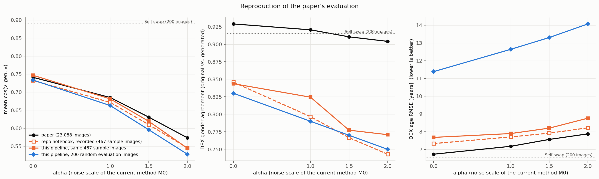
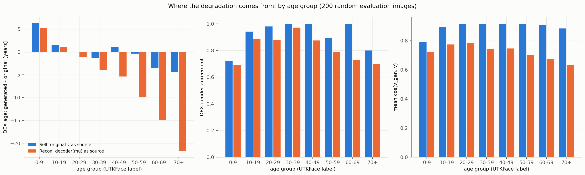

# Report 003：GHOSTで生成した画像による匿名性と属性保持の評価（作業前の確認で中断）

## 1. 概要

GHOSTで実際に画像を生成し，再識別率をそろえてDEXによる属性の保持を比べる実験の準備を行った．**作業前の確認のうち「予稿の再現」が許容範囲を外れたため，本実験は実行していない．** 得られたことは次のとおりである．

1. **GHOSTは既存の環境を変更せずに動かせる．** mxnet を必要とするのは，生成した顔を元画像へ貼り戻す処理だけであり，予稿と同じ評価処理は貼り戻す前の顔画像を使う．
2. **予稿の値は再現できなかった．** コサイン類似度は $` \alpha = 0 `$ と $` \alpha = 1 `$ では許容範囲内であるが，$` \alpha = 1.5 `$ で −0.035，$` \alpha = 2 `$ で −0.046 ずれた．性別一致率は 0.75〜0.83 で，予稿の 0.90〜0.93 を大きく下回り，年齢のRMSEは 11.4〜14.1 歳で，予稿の 6.7〜7.9 歳を大きく上回った．
3. **ずれの原因は，今回の実装ではなく，リポジトリの評価処理・重みと予稿との間にある．** リポジトリ同梱のnotebookに記録されている作者自身の実行結果は，予稿ではなく今回の結果とほぼ一致する．同じ画像 467 枚で今回の処理を実行すると，その記録とコサイン類似度で 0.014 以内，性別一致率で 0.03 以内で一致した．
4. **属性の劣化の大半は，サンプリングではなくVAEの再構成で生じている．** 元の顔ベクトルをそのままGHOSTに渡した場合の性別一致率は 0.915，年齢のRMSEは 6.6 歳であるが，再構成 $` \mathbf v_0 `$ を渡すと 0.830 と 11.4 歳になる．再構成は高齢者を大幅に若返らせ，70 歳以上では平均 21.6 歳若く推定される．
5. 線形分類器に不具合は無かった．性別の正解率 0.805 は正則化の強さに由来し，上限は 0.825 程度である．同じ画像に対するDEXの正解率は 0.888 である．

予稿の値と一致する評価の条件が特定できていないため，本実験の結果を予稿と比較可能な形で示すことができない．次に何を基準として進めるかの判断が必要である（9章）．

## 2. GHOSTの環境

mxnet を import しているのは `third_party/ghost/coordinate_reg/image_infer.py` だけである．このファイルが定義する106点のランドマーク検出器 `Handler` は，`get_final_image`，すなわち生成した顔を元画像の該当位置へマスクを使って貼り戻す処理でのみ使われる．

一方，予稿の評価に対応する `identity_anonymizer.evaluation.metrics.evaluate_single_image` は，`anonymize_image` が返す2つの画像のうち，貼り戻す前の顔画像 (256×256) をArcFaceとDEXに入力する．貼り戻した画像は評価に使われない．したがって，顔検出器，生成器，ArcFace，DEXだけを読み込めば評価を行える．

**既存のconda環境は変更していない．** 新しい環境も作成していない．診断用のスクリプトのプロセス内に限り，次の2つの回避策を用いた．

- `mxnet` と `dill` が import できない場合，空のモジュールで代用する．`dill` は超解像モデルの補助関数でのみ使われ，今回は使わない．この代用により，既存のモジュールを変更せずに import できる．
- `insightface==0.2.1` が `onnxruntime` のセッションを providers の指定なしで生成して例外になるため，providers の既定値を補う．

顔の切り出し，生成器への入力の前処理，ArcFaceの再抽出，DEXの前処理は，既存の `anonymize_image` と `evaluate_single_image` と同じ関数を同じ順序で用いた．既存の実装は1枚ずつ処理するが，今回はバッチで処理する．両者の出力を8枚で比べたところ，生成画像の画素値の差は最大 1，DEXの年齢の差は最大 0.07 歳，再抽出した顔ベクトルのコサイン類似度の差は $` 10^{-5} `$ 程度であった．半精度演算の丸めの範囲である．切り出した顔から再計算した顔ベクトルは，ex001 のキャッシュと最大 $` 1.2 \times 10^{-5} `$ の差で一致した．

貼り戻した画像を得るには mxnet が必要であり，その場合は新しい環境の作成が必要になる．今回はその必要が無かった．

## 3. DEXの読み込みと精度

`weights/dex/` の年齢・性別推定モデルは問題なく動作した．前処理は `identity_anonymizer.evaluation.age_gender` と同一であり，顔画像を 224×224 にリサイズし，BGRのまま，0〜255の値を正規化せずに入力する．年齢は出力確率の期待値，性別は女性の確率が男性の確率を上回るかどうかで決める．元画像に対しては切り出した顔画像 (224×224) を入力し，生成画像に対しては生成器の出力 (256×256) を入力する．

**表1** UTKFaceの元画像に対するDEXと線形分類器の精度（ラベルに対する正解率）

| 画像の集合 | 枚数 | DEXの性別正解率 | 線形分類器の性別正解率 | DEXの年齢のMAE [歳] | 線形分類器の年齢のMAE [歳] | DEXと線形分類器の性別の一致率 |
| :---: | :---: | :---: | :---: | :---: | :---: | :---: |
| 評価用データの全体 | 4,614 | 0.888 | 0.805 | 7.48 | 9.59 | 0.765 |
| 本実験用の1,000枚 | 1,000 | 0.881 | 0.785 | 8.75 | 10.26 | 0.742 |
| 再現用の200枚 | 200 | 0.910 | 0.810 | 8.25 | 10.63 | 0.790 |

DEXは線形分類器より正確であるが，性別の正解率は 0.89 に留まる．DEXと線形分類器の性別の予測は，元画像に対しても 77% しか一致しない．

## 4. 予稿の再現

評価用データから無作為に選んだ 200 枚について，現行方式 M0 で顔画像を生成して評価した．予稿の本文の表には $` \alpha = 1.0, 1.5, 2.0 `$ の値が載っており，指示にあった $` \alpha = 0 `$ の値と合わせて4点で比べた．予稿の値は 23,088 枚の平均である．

**表2** 予稿の再現（評価用データから無作為に選んだ200枚）

| $` \alpha `$ | cos類似度 実測 / 予稿 | 差 | 性別一致率 実測 / 予稿 | 年齢のRMSE 実測 / 予稿 [歳] | 再識別率 top-1 | ベクトル空間の $` \cos(\tilde{\mathbf v}, \mathbf v) `$ |
| :---: | :---: | :---: | :---: | :---: | :---: | :---: |
| 0 | 0.733 / 0.741 | −0.008 | 0.830 / 0.929 | 11.38 / 6.73 | 1.000 | 0.815 |
| 1 | 0.663 / 0.685 | −0.022 | 0.790 / 0.921 | 12.64 / 7.17 | 1.000 | 0.733 |
| 1.5 | 0.596 / 0.631 | **−0.035** | 0.770 / 0.911 | 13.31 / 7.56 | 0.995 | 0.658 |
| 2 | 0.528 / 0.573 | **−0.046** | 0.750 / 0.904 | 14.07 / 7.88 | 0.970 | 0.583 |

**コサイン類似度は $` \alpha = 1.5 `$ と $` \alpha = 2 `$ で 0.03 以上ずれた．** 200 枚での平均の標準誤差は約 0.01 であり，抽出の偶然では説明できない．性別一致率と年齢のRMSEは，$` \alpha = 0 `$ の時点で既に予稿から大きく離れている．

## 5. ずれの切り分け

### 5.1 リポジトリのnotebookの記録との照合

`notebooks/05_evaluate.ipynb` には，作者が既存のパイプライン（mxnet を含む完全な環境）で，同梱のサンプル画像に対して実行した結果が出力として残っている．同じサンプル画像に今回の処理を適用して比べた．顔を検出できた枚数は，どちらも 500 枚中 467 枚である．

**表3** 同じサンプル画像 467 枚での比較

| $` \alpha `$ | cos類似度 今回 / notebook / 予稿 | 性別一致率 今回 / notebook / 予稿 | 年齢のRMSE 今回 / notebook / 予稿 [歳] |
| :---: | :---: | :---: | :---: |
| 0 | 0.747 / 0.732 / 0.741 | 0.844 / 0.846 / 0.929 | 7.68 / 7.33 / 6.73 |
| 1 | 0.681 / 0.672 / 0.685 | 0.824 / 0.797 / 0.921 | 7.89 / 7.70 / 7.17 |
| 1.5 | 0.619 / 0.610 / 0.631 | 0.777 / 0.767 / 0.911 | 8.20 / 7.92 / 7.56 |
| 2 | 0.545 / 0.546 / 0.573 | 0.771 / 0.743 / 0.904 | 8.76 / 8.22 / 7.88 |

**今回の処理はリポジトリの既存のパイプラインとほぼ同じ結果を与える．** そして，既存のパイプライン自身が予稿の値を再現していない．notebookの記録でも，性別一致率は 0.74〜0.85 であり，予稿の 0.90〜0.93 より 8〜16 ポイント低く，$` \alpha = 2 `$ のコサイン類似度は 0.546 で予稿より 0.028 低い．

今回の処理とnotebookの記録の間にも小さな差が残る．乱数に依存しない $` \alpha = 0 `$ でコサイン類似度が 0.014，年齢のRMSEが 0.35 歳異なる．顔検出器がCPUで動作していること，GPUやライブラリの版の違いによる半精度演算の差が候補であるが，特定していない．

図1に3者の比較を示す．横軸は $` \alpha `$，縦軸は左から順にコサイン類似度，DEXの性別一致率，年齢のRMSEである．黒が予稿，橙の破線がnotebookの記録，橙の実線が同じ 467 枚での今回の処理，青が評価用データの 200 枚での今回の処理，点線が 200 枚での Self である．

**図1** 予稿の値，リポジトリのnotebookの記録，今回の処理による実測の比較

### 5.2 画像の集合による違い

表2と表3で年齢のRMSEが大きく異なる（$` \alpha = 0 `$ で 11.4 歳と 7.7 歳）のは，画像の年齢の構成が違うためである．

**表4** ラベルの年代の構成比

| 年代 | サンプル画像 500 枚 | 評価用データ 4,614 枚 | 再現用 200 枚 | 本実験用 1,000 枚 |
| :---: | :---: | :---: | :---: | :---: |
| 0〜9 | 0.078 | 0.147 | 0.160 | 0.146 |
| 10〜19 | 0.180 | 0.064 | 0.085 | 0.123 |
| 20〜29 | 0.236 | 0.304 | 0.250 | 0.146 |
| 30〜39 | 0.498 | 0.188 | 0.175 | 0.147 |
| 40〜49 | 0.000 | 0.095 | 0.080 | 0.129 |
| 50〜59 | 0.000 | 0.090 | 0.095 | 0.115 |
| 60〜69 | 0.000 | 0.052 | 0.055 | 0.098 |
| 70 以上 | 0.008 | 0.061 | 0.100 | 0.096 |

同梱のサンプル画像は 40 歳以上をほとんど含まない．一方，UTKFace全体には 40 歳以上が約 3 割含まれる．5.3節のとおり，属性の劣化は高齢者で特に大きいため，サンプル画像での値は全体での値より良く出る．予稿は全画像の平均で 6.73 歳と報告しているが，今回の処理で全体の分布から抽出した 200 枚では 11.4 歳であり，画像の集合の違いでは予稿とのずれを説明できない．

### 5.3 劣化はどこで生じているか

再現用の 200 枚について，元の顔ベクトル $` \mathbf v `$ をそのままソースにした場合（Self）と，再構成 $` \mathbf v_0 = \mathrm{decoder}(\boldsymbol\mu) `$ をソースにした場合（Recon，M0 の $` \alpha = 0 `$）を比べた．

**表5** Self と Recon の比較（再現用の200枚，年代はラベルによる）

| 年代 | 枚数 | cos類似度 Self / Recon | 性別一致率 Self / Recon | 年齢の変化の平均 Self / Recon [歳] | 年齢のRMSE Self / Recon [歳] |
| :---: | :---: | :---: | :---: | :---: | :---: |
| 全体 | 200 | 0.889 / 0.733 | 0.915 / 0.830 | +0.3 / −4.4 | 6.57 / 11.38 |
| 0〜9 | 32 | 0.792 / 0.720 | 0.719 / 0.688 | +6.2 / +5.3 | 10.55 / 9.67 |
| 10〜19 | 17 | 0.894 / 0.773 | 0.941 / 0.882 | +1.5 / +1.1 | 4.05 / 3.86 |
| 20〜29 | 50 | 0.913 / 0.782 | 0.980 / 0.880 | −0.0 / −1.1 | 4.79 / 4.31 |
| 30〜39 | 35 | 0.916 / 0.745 | 1.000 / 0.971 | −1.3 / −4.0 | 5.05 / 7.59 |
| 40〜49 | 16 | 0.914 / 0.746 | 1.000 / 0.875 | +1.0 / −5.4 | 4.83 / 9.88 |
| 50〜59 | 19 | 0.912 / 0.703 | 0.895 / 0.789 | −0.4 / −9.8 | 5.00 / 13.34 |
| 60〜69 | 11 | 0.906 / 0.673 | 1.000 / 0.727 | −3.5 / −14.9 | 5.16 / 16.62 |
| 70 以上 | 20 | 0.884 / 0.633 | 0.800 / 0.700 | −4.3 / −21.6 | 8.95 / 24.24 |

「年齢の変化」は，DEXが生成画像に対して推定した年齢から，元画像に対して推定した年齢を引いた値である．次のことが分かる．

- **GHOST自体による劣化は小さい．** Self では性別一致率 0.915，年齢のRMSE 6.57 歳であり，年齢の偏りもほぼ無い．再識別率は 1.0 である．
- **VAEの再構成が属性を大きく損なう．** Recon では性別一致率が 0.830 に下がり，年齢は平均 4.4 歳若くなる．**若返りは年齢が高いほど大きく，70 歳以上では平均 21.6 歳，60 代では 14.9 歳である．** 再構成された顔ベクトルは，平均的な若い成人の顔に引き寄せられている．
- この結果は report_002 の「属性は再構成の段階で大きく失われている」という結論と一致し，線形分類器ではなくDEXでも同じことが確認された．
- 子どもの画像では Self でも性別一致率が 0.72 と低く，年齢が 6 歳高く推定される．GHOSTとDEXがともに子どもの顔を苦手としていると考えられる．

**予稿の $` \alpha = 0 `$ の値との関係に注意が必要である．** 予稿の性別一致率 0.929 と年齢のRMSE 6.73 歳は，今回の Recon（0.830，11.38 歳）ではなく Self（0.915，6.57 歳）に近い．一方，予稿のコサイン類似度 0.741 は Recon（0.733）に近く，Self（0.889）とは大きく異なる．予稿の3つの値を同時に与える条件は，今回の処理の中には見当たらない．

図2に年代別の内訳を示す．横軸はラベルの年代，縦軸は左から順に，年齢の変化の平均，性別一致率，コサイン類似度である．青が Self，橙が Recon である．

**図2** Self と Recon の年代別の比較（再現用の200枚）

### 5.4 DEXの入力の違いの検討

予稿の評価が，切り出した顔ではなく画像の全体をDEXに入力していた可能性を検討した．貼り戻した画像は mxnet が無いと作れないため，元画像についてのみ，全体を入力した場合と切り出した顔を入力した場合を比べた．

**表6** DEXの入力による違い（再現用の200枚の元画像）

| 指標 | 画像の全体 | 切り出した顔 |
| :---: | :---: | :---: |
| 性別の正解率 | 0.840 | 0.910 |
| 年齢のMAE [歳] | 11.21 | 8.25 |

両者の性別の予測の一致率は 0.840，年齢の差のRMSEは 9.97 歳である．画像の全体を入力するとDEXの精度は下がるため，この違いが予稿の高い一致率を説明するとは考えにくい．ただし，貼り戻した画像同士を比べた場合の一致率は確認できていない．

### 5.5 ずれの原因の候補

原因は特定できていない．候補を可能性の高いと考える順に挙げる．

1. **予稿の評価に使われたVAEの重みが，同梱の `vae_512_128.pt` と異なる．** 予稿は潜在変数を512次元と記しているが，同梱の重みは128次元である．潜在次元が大きいVAEであれば，再構成での属性の損失が小さくなり，性別一致率と年齢のRMSEが Self に近い値になることと整合する．ただし，その場合にコサイン類似度が 0.741 に留まる理由は説明できない．
2. **予稿の評価処理が，同梱の `evaluate_single_image` と異なる．** `evaluate_single_image` の説明文は，元の実装が `004_GHOST_VAE_inference_v2.ipynb` の評価ループであったと述べているが，このnotebookはリポジトリに含まれていない．DEXへの入力画像，顔の切り出し方，集計の対象が異なっていた可能性がある．
3. **評価の対象となった画像が異なる．** 予稿は 23,088 枚と記しており，顔を検出できた 23,125 枚より 37 枚少ない．評価の途中で除外された画像があったと考えられるが，37 枚の違いで今回のずれは生じない．

## 6. 線形分類器の健全性

ex002 と同じデータ分割で，正則化の強さと標準化の有無を変えて学習し直した．

**表7** 線形分類器の正則化の強さと評価用データでの精度（標準化あり）

| 性別・人種の $` C `$ | 性別の正解率 学習 / 評価 | 人種の正解率 学習 / 評価 | 反復回数 性別 / 人種 | 重みのノルム 性別 |
| :---: | :---: | :---: | :---: | :---: |
| 0.0001 | 0.731 / 0.733 | 0.605 / 0.610 | 9 / 22 | 0.36 |
| 0.001 | 0.744 / 0.734 | 0.659 / 0.652 | 14 / 21 | 0.89 |
| 0.01 | 0.756 / 0.747 | 0.677 / 0.663 | 37 / 43 | 1.97 |
| 0.1 | 0.784 / 0.766 | 0.708 / 0.698 | 99 / 112 | 8.11 |
| 1（ex002 の設定） | 0.819 / 0.805 | 0.761 / 0.738 | 231 / 243 | 29.6 |
| 10 | 0.832 / 0.825 | 0.786 / 0.759 | 349 / 485 | 60.5 |
| 100 | 0.834 / 0.825 | 0.788 / 0.758 | 466 / 566 | 73.9 |

- **収束の警告は，どの設定でも出なかった．** 反復回数は上限の 3,000 回に対して最大 596 回である．
- **標準化の有無は結果に影響しない．** 標準化しない場合の評価用データでの正解率は，全ての $` C `$ で標準化した場合と 0.002 以内で一致した．
- **正則化を弱めると精度が上がり，$` C = 10 `$ で頭打ちになる．** 性別は 0.825，人種は 0.759 である．ex002 の 0.805 は不具合ではなく，$` C = 1 `$ という設定によるものであり，線形モデルの上限は 0.825 程度である．
- 年齢のリッジ回帰は，正則化が弱いほど良く，MAEは 9.59 歳（$` \alpha_{\mathrm{ridge}} = 1 `$）である．正則化を強めると 11〜13 歳に悪化する．

正則化が弱いほど精度が上がり，重みのノルムが大きくなることは，属性の情報が顔ベクトルの分散の小さい方向に含まれていることを示す．report_002 で見た「等方的なノイズに極端に弱い」という性質は，この構造から生じている．線形分類器は実装としては健全であるが，DEX（性別 0.888）より精度が低く，DEXとの予測の一致率も 0.77 に留まるため，属性の評価の道具としてはDEXの代わりにならない．

## 7. 評価に使う画像と所要時間の見積もり

本実験のための準備として，次のものは作成済みである．

- 評価用データ 4,614 枚の全てについて，顔の切り出しをキャッシュした．顔の検出は全て成功した．
- 本実験用の 1,000 枚を，性別×人種×年代の層に均等に割り当てる層化抽出で選んだ．78 層のうち枚数の少ない層は全て採用し，不足分を残りの層に再配分した．性別は男性 529・女性 471，人種は 0 から順に 240・222・185・205・148，年代は表4のとおりである．
- ベクトル空間でパラメータを較正するスクリプト（`calibrate.py`）と，全設定の生成と評価を行うスクリプト（`generate.py`）を作成した．**どちらも実行していない．**

所要時間は，再現用の 200 枚での実測から見積もった．1設定あたりの生成と評価（生成，ArcFaceの再抽出，DEX，再識別）は 200 枚で約 1.9 秒である．1,000 枚では1設定あたり約 10 秒，設定数を約 27 とすると合計で約 5 分になる．生成画像に対する顔検出はCPUで1枚あたり約 0.05 秒であり，27,000 枚で約 25 分，4並列で約 10 分である．**全体で 30 分以内に収まる見込みであり，6 時間の上限には遠い．** 50 枚での試行は，本実験の一部であるため実行していない．

## 8. 冒頭の問いに対する現時点での答え

本実験を実行していないため，3つの問いには答えられていない．作業前の確認から言えることだけを記す．

- **問い1（匿名性と属性の保持の両立）**：未回答である．ただし，現行方式は $` \alpha = 2 `$ でも再識別率が 0.97 であり，その時点で性別一致率は 0.75 まで下がっている．再構成だけで 0.83 まで下がるため，現在のVAEでは，匿名性が得られる前に属性が失われている．
- **問い2（M2・M3u と M0 の比較）**：未回答である．
- **問い3（ベクトル空間の評価の妥当性）**：部分的に分かった．コサイン類似度は，画像から再抽出すると，ベクトル空間での値より一貫して 0.055〜0.08 低い（表2）．これはGHOSTを通すことによる損失であり，Self でも 0.889 に下がることと対応する．再識別率は，$` \alpha \le 1 `$ では画像でも 1.0 である．属性については，線形分類器はDEXの代わりにならない（6章）．

## 9. 次に判断が必要なこと

予稿の値を再現する条件が分からないため，何を基準として本実験を進めるかを決める必要がある．選択肢を挙げる．いずれも未実施である．

1. **リポジトリのパイプラインを基準として本実験を進める．** 今回の処理はリポジトリのnotebookの記録と一致しているため，予稿の絶対値との比較は諦め，Self，Recon，Other を基準とした相対的な比較として本実験を行う．準備は済んでおり，約 30 分で実行できる．3つの問いには，この方法で答えられる．
2. **予稿の評価に使った重みと処理を確認する．** 予稿の実験に使ったVAEの重み（潜在次元が512のものが存在するか）と，`004_GHOST_VAE_inference_v2.ipynb` の評価ループを確認する．これらが手元にあれば，ずれの原因を直接特定できる．
3. **貼り戻した画像での評価を試す．** mxnet が動く環境を新たに作り，貼り戻した画像をDEXに入力した場合の値を調べる．CPU版の mxnet を入れた新しい環境を作れば，既存の環境を変更せずに実行できる見込みであるが，5.4節の結果からは，これが原因である可能性は高くないと考える．

本実験の結果がどうであれ，5.3節の結果はVAEの再学習が必要であることを強く示唆している．再構成だけで性別一致率が 0.915 から 0.830 に下がり，高齢者が 15〜22 歳若返る状態では，サンプリング方式をどう工夫しても，属性の保持は再構成の水準を超えられない．再学習の際は，再構成 $` \mathbf v_0 `$ をGHOSTに渡したときのDEXの性別一致率と年代別の年齢の偏りを，Self の値（0.915，偏りほぼ 0）にどこまで近づけられるかを指標にするのが適切である．

## 10. 未解決の論点

- 予稿の値と今回の値のずれの原因は特定できていない．
- 今回の処理とリポジトリのnotebookの記録の間に残る小さな差（$` \alpha = 0 `$ でコサイン類似度 0.014）の原因は特定していない．
- 予稿の再現は 200 枚，Self と Recon の年代別の内訳は年代ごとに 11〜50 枚での結果であり，年代別の値には数ポイントの不確かさがある．
- 貼り戻した画像に対する評価，ArcFace以外の顔認識モデルによる再識別率，生成画像での顔検出の成功率は，いずれも未実施である．
