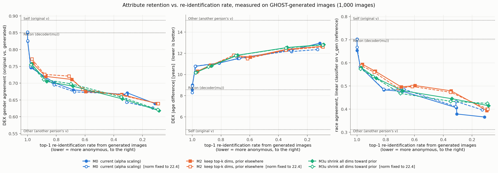
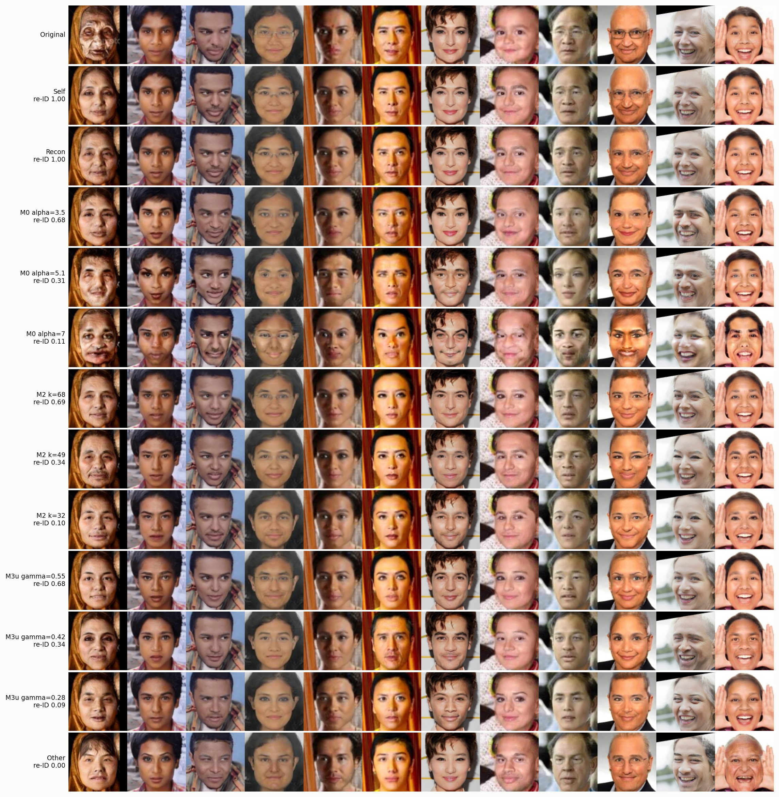
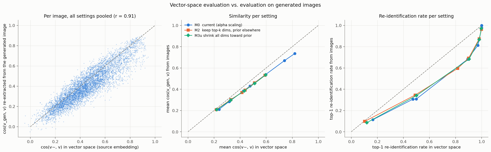
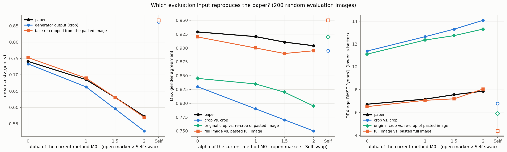

# Report 004：GHOSTで生成した画像による評価（本実験）と，貼り戻した画像での評価

## 1. 概要

report_003 で中断していた本実験を実行し，あわせて予稿の値を再現する評価条件を特定した．結論は次のとおりである．

1. **予稿の値を再現する条件が見つかった．** DEXには「元画像の全体」と「生成した顔を貼り戻した画像の全体」を入力し，コサイン類似度は貼り戻した画像から改めて切り出した顔で計算する．この条件で，性別一致率，年齢のRMSE，コサイン類似度の3つが同時に予稿の値と一致した．
2. **ただし，この条件での高い一致率は，属性が保たれていることを意味しない．** 画像の全体をDEXに入力すると，ソースを全くの他人の顔ベクトルに置き換えても性別一致率は 0.875 になる．予稿の $` \alpha = 2 `$ の値 0.904 は，自分自身との顔交換の 0.95 より，この他人の水準に近い．貼り戻した画像は顔の内側以外が元画像と同一であり，DEXの予測が髪や輪郭などの文脈に強く依存するためである．
3. **現行のVAEのままでは，匿名性と属性の保持は両立しない．** 生成した顔そのものをDEXに入力すると，再識別率を 0.1 まで下げた時点で性別一致率は 0.62〜0.64 である．自分自身との顔交換の 0.887 と，他人の顔に置き換えた場合の 0.562 の間で，保たれているのは約 2 割である．
4. **M2・M3u は，同じ再識別率で現行方式 M0 より属性を保てない．** 再識別率 0.9，0.5，0.1 のどの水準でも，3つの方式の性別一致率と年齢の差は誤差の範囲で一致した．ただし M0 は $` \alpha `$ を大きくすると顔が崩れるのに対し，M2 と M3u は自然な顔を保つ．
5. **ベクトル空間の評価は，類似度については画像での評価の代わりになる．** 画像から再抽出した類似度は，ベクトル空間での値のほぼ 0.9 倍である．再識別率は対応するが，ベクトル空間の方が高く出る．線形分類器による属性の評価は，DEXの代わりにならない．
6. ノルムの補正はほとんど効果が無かった．
7. **貼り戻した画像は，生成器が出力した顔より匿名性が低い．** 貼り戻した画像から顔を切り出し直して再識別すると，生成器の出力では 0.31〜0.35 であった再識別率が 0.58〜0.62 になる．実際に出力として使われるのは貼り戻した画像であるため，匿名性は貼り戻した画像で評価する必要がある．
8. **既存のパイプラインに色チャネルの不整合が見つかった．** `anonymize_image` は，BGRの順序のままの顔画像から計算した顔ベクトルをVAEに渡している．VAEの学習と評価はRGBの順序で行われており，この不整合でコサイン類似度が 0.02〜0.03 下がる．既存のコードは変更していない．

## 2. 実験条件

**表1** 実験条件

| 項目 | 設定 |
| :---: | :--- |
| 画像 | ex002 の評価用データから，性別×人種×年代で層化抽出した 1,000 枚（乱数シード 0） |
| 再識別の探索対象 | 顔ベクトルを抽出できた全 23,125 枚 |
| サンプル数 | 各画像・各設定で1本（乱数シード 0） |
| ノルムの扱い | 補正なし，および学習用データの平均ノルム 22.40 へのスケーリング |
| 生成 | 匿名化の対象画像そのものをターゲットとし，$` \tilde{\mathbf v} `$ をソースの埋め込みとしてGHOSTに渡す |
| 評価（3〜7章） | 生成器が出力した顔画像（256×256）からArcFaceの顔ベクトル $` \mathbf v_{\mathrm{gen}} `$ を再抽出し，DEXにも同じ顔画像を入力する．リポジトリの `evaluate_single_image` と同じ処理である |

50 枚での試行は正常に終了し，1設定あたり 0.5 秒であった．1,000 枚での本実験は 40 設定で 368 秒であった．

再識別率の目標値に相当するパラメータは，この 1,000 枚についてベクトル空間で細かく掃引し直して選んだ（各画像 10 本）．

**表2** 較正で選んだパラメータ（ベクトル空間での再識別率 top-1 が目標値に最も近いもの）

| 方式 | 目標 0.9 | 目標 0.5 | 目標 0.1 |
| :---: | :---: | :---: | :---: |
| M0（$` \alpha `$） | 3.5（0.893） | 5.1（0.489） | 7.0（0.174，掃引の上限） |
| M2（$` k `$） | 68（0.898） | 49（0.489） | 32（0.104） |
| M3u（$` \gamma `$） | 0.55（0.900） | 0.42（0.508） | 0.28（0.103） |

括弧内はベクトル空間での再識別率である．M0 は $` \alpha = 7 `$ まで掃引しても 0.17 までしか下がらなかった．これらに加えて，指示にあった M0 の $` \alpha = 5 `$，M2 の $` k = 64 `$ と，再識別率が高い側の曲線を補うための M0 の $` \alpha = 1, 2, 3 `$，M2 の $` k = 80, 96 `$，M3u の $` \gamma = 0.65, 0.75 `$ を生成した．

## 3. 基準となる3つの設定

**表3** Self，Recon，Other の評価値（1,000 枚）

| 設定 | ソース | $` \cos(\mathbf v_{\mathrm{gen}}, \mathbf v) `$ | 再識別率 top-1 | DEXの性別一致率 | DEXの年齢の差の絶対値 [歳] | 年齢のRMSE [歳] | 年齢の変化の平均 [歳] | 人種の一致率（線形分類器） |
| :---: | :--- | :---: | :---: | :---: | :---: | :---: | :---: | :---: |
| Self | 元の $` \mathbf v `$ | 0.885 | 1.000 | 0.887 | 4.81 | 6.85 | −0.3 | 0.784 |
| Recon | $` \mathbf v_0 = \mathrm{decoder}(\boldsymbol\mu) `$ | 0.735 | 1.000 | 0.850 | 8.57 | 12.31 | −5.3 | 0.703 |
| Other | 他人の実際の $` \mathbf v `$ | 0.033 | 0.000 | 0.562 | 15.11 | 19.36 | −1.3 | 0.312 |

- **Self** はGHOSTによる劣化の上限である．自分自身の顔ベクトルを渡しても，類似度は 0.885，性別一致率は 0.887 に留まる．
- **Other** は属性が保持されない場合の下限である．性別一致率が 0.5 ではなく 0.562 になるのは，ターゲットの画像の髪型や輪郭が生成画像に残り，DEXの判断に影響するためと考えられる．
- **Recon** はVAEの再構成による劣化である．Self と Other の差を 100% とすると，再構成だけで性別は 11%，年齢は 36% が失われる．

## 4. 再識別率をそろえた属性保持の比較

### 4.1 トレードオフ曲線

図1に最も重要な結果を示す．横軸は生成画像での再識別率 top-1 であり，右へ行くほど匿名性が高い．縦軸は左から順に，DEXの性別一致率，DEXの年齢の差の絶対値，人種の一致率である．人種はDEXでは推定できないため，$` \mathbf v_{\mathrm{gen}} `$ に ex002 の線形分類器を適用した参考値である．実線はノルムの補正なし，破線は補正ありである．点線は Self，Recon，Other である．

**図1** 生成画像での再識別率に対する属性保持のトレードオフ曲線

**3つの方式の曲線は，DEXの性別と年齢についてほぼ重なる．** 再識別率が下がるにつれて，どの方式も同じ経路をたどって Other の水準へ近づく．

### 4.2 再識別率の各水準での比較

方式ごとの設定を，生成画像での再識別率について線形補間した．

**表4** 生成画像での再識別率をそろえた比較（ノルムの補正なし）

| 再識別率 top-1 | 方式 | 補間したパラメータ | $` \cos(\mathbf v_{\mathrm{gen}}, \mathbf v) `$ | 再識別率 top-10 | 性別一致率 | 年齢の差の絶対値 [歳] | 年齢のRMSE [歳] | 人種の一致率（線形分類器） |
| :---: | :---: | :---: | :---: | :---: | :---: | :---: | :---: | :---: |
| 0.9 | M0 | $` \alpha = 2.47 `$ | 0.487 | 0.974 | 0.725 | 10.91 | 14.99 | 0.536 |
| 0.9 | M2 | $` k = 84.8 `$ | 0.481 | 0.978 | 0.732 | 10.71 | 14.84 | 0.573 |
| 0.9 | M3u | $` \gamma = 0.68 `$ | 0.481 | 0.983 | 0.722 | 10.62 | 14.77 | 0.549 |
| 0.5 | M0 | $` \alpha = 4.23 `$ | 0.335 | 0.730 | 0.673 | 11.92 | 15.85 | 0.442 |
| 0.5 | M2 | $` k = 58.3 `$ | 0.344 | 0.739 | 0.672 | 11.92 | 16.06 | 0.493 |
| 0.5 | M3u | $` \gamma = 0.48 `$ | 0.338 | 0.723 | 0.671 | 12.20 | 16.32 | 0.461 |
| 0.1 | M0 | $` \alpha = 7 `$（再識別率 0.113） | 0.210 | 0.253 | 0.639 | 12.95 | 16.54 | 0.366 |
| 0.1 | M2 | $` k = 32.2 `$ | 0.208 | 0.237 | 0.639 | 12.65 | 16.63 | 0.395 |
| 0.1 | M3u | $` \gamma = 0.29 `$ | 0.212 | 0.247 | 0.620 | 12.81 | 17.08 | 0.417 |

M0 は掃引の範囲で再識別率 0.1 に届かなかったため，最も近い $` \alpha = 7 `$ の値を示した．1,000 枚での性別一致率の標準誤差は約 0.015 である．

**再識別率 0.1 での属性の保持の水準は，性別一致率 0.62〜0.64，年齢の差 12.7〜13.0 歳である．** Self（0.887，4.81 歳）と Other（0.562，15.11 歳）の差を 100% とすると，保たれているのは性別で 18〜24%，年齢で 21〜24% に過ぎない．再識別率 0.5 でも 28〜34%，0.9 でも 41〜52% である．

**表5** Self と Other の差を 100% としたときの属性の保持率

| 再識別率 top-1 | 性別（M0 / M2 / M3u） | 年齢（M0 / M2 / M3u） |
| :---: | :---: | :---: |
| 1.0（Recon） | 89% | 64% |
| 0.9 | 50% / 52% / 49% | 41% / 43% / 44% |
| 0.5 | 34% / 34% / 33% | 31% / 31% / 28% |
| 0.1 | 24% / 24% / 18% | 21% / 24% / 22% |

### 4.3 方式間の対応のある比較

較正で選んだ設定は，ベクトル空間での再識別率が方式間でそろっている．同じ画像に対する差を，画像のブートストラップで評価した．

**表6** M2・M3u と M0 の差（ノルムの補正なし，括弧内は 95% 信頼区間）

| ベクトル空間での水準 | 比較 | 再識別率 top-1 の差 | 性別一致率の差 | 年齢の差の絶対値の差 [歳] |
| :---: | :---: | :---: | :---: | :---: |
| 0.9 | M2（$` k = 68 `$）− M0（$` \alpha = 3.5 `$） | +0.010（−0.027〜+0.046） | +0.031（−0.007〜+0.070） | +0.26（−0.23〜+0.77） |
| 0.9 | M3u（$` \gamma = 0.55 `$）− M0 | +0.002（−0.035〜+0.037） | +0.011（−0.026〜+0.048） | +0.31（−0.22〜+0.81） |
| 0.5 | M2（$` k = 49 `$）− M0（$` \alpha = 5.1 `$） | +0.039（+0.001〜+0.076） | −0.005（−0.046〜+0.035） | +0.06（−0.52〜+0.59） |
| 0.5 | M3u（$` \gamma = 0.42 `$）− M0 | +0.034（−0.002〜+0.070） | −0.018（−0.057〜+0.022） | +0.23（−0.33〜+0.79） |
| 0.1 | M2（$` k = 32 `$）− M0（$` \alpha = 7 `$） | −0.016（−0.041〜+0.010） | 0.000（−0.040〜+0.042） | −0.30（−0.92〜+0.33） |
| 0.1 | M3u（$` \gamma = 0.28 `$）− M0 | −0.027（−0.051〜−0.003） | −0.021（−0.060〜+0.017） | −0.13（−0.77〜+0.48） |

**性別一致率と年齢の差は，どの水準でも信頼区間が 0 を含む．** DEXで見るかぎり，M2 と M3u は M0 より属性を保てていない．ex002 で線形分類器が示した M2 の小さな優位は，DEXでは確認できなかった．線形分類器による人種の一致率だけは，M2 が M0 より 3〜5 ポイント高い（表4）．

### 4.4 年代別の内訳

**表7** DEXが推定した年齢の変化の平均 [歳]（生成画像 − 元画像，ラベルの年代別）

| 設定 | 0〜9 | 10〜19 | 20〜29 | 30〜39 | 40〜49 | 50〜59 | 60〜69 | 70 以上 |
| :---: | :---: | :---: | :---: | :---: | :---: | :---: | :---: | :---: |
| Self | +5.5 | 0.0 | +0.4 | −0.6 | −0.8 | −0.6 | −2.6 | −6.5 |
| Recon | +4.8 | +0.1 | −0.4 | −2.9 | −6.4 | −11.7 | −16.1 | −18.2 |
| M0（$` \alpha = 7 `$） | +11.4 | +9.9 | +4.5 | +1.2 | −4.8 | −13.3 | −17.7 | −25.9 |
| M2（$` k = 32 `$） | +7.8 | +5.3 | +1.3 | −3.5 | −9.6 | −16.9 | −21.5 | −28.5 |
| M3u（$` \gamma = 0.28 `$） | +7.7 | +5.1 | +2.1 | −3.3 | −10.2 | −15.9 | −23.0 | −30.2 |
| Other | +14.6 | +11.0 | +8.0 | +2.0 | −5.4 | −13.5 | −15.7 | −25.7 |

各年代の枚数は 96〜147 枚である．**再構成の時点で，50 歳以上は 12〜18 歳若返る．** 再識別率を 0.1 まで下げた設定では，子どもは年上に，高齢者は年下に推定され，全ての年代が 30〜40 歳前後に集まる．これは Other と同じ傾向であり，年齢の情報がほぼ失われていることを示す．M2 は「年齢に関連する次元」を保持する方式であったが，高齢者の若返りは M0 より大きい．

### 4.5 画像の品質

生成画像での顔検出の成功率は，全 40 設定で 1.000 であった．生成画像は顔が画面いっぱいに写っており，そのままでは元の切り出し画像でも検出できないため，周囲に 64 画素の余白を付けて検出した．各設定の先頭 300 枚で確認した．

図2に生成画像の比較を示す．列が画像，行が設定であり，行のラベルの数値はその設定での再識別率である．

**図2** 生成画像の比較（上から，元画像，Self，Recon，M0，M2，M3u の各水準，Other）

顔検出は成功していても，**M0 の $` \alpha = 7 `$ では，目や口の周りに明らかな崩れが生じている．** $` \alpha = 7 `$ のソースの顔ベクトルのノルムは平均 52 であり，実データの 22 を大きく超えている．同じ再識別率の水準にある M2（$` k = 32 `$）と M3u（$` \gamma = 0.28 `$）は自然な顔を保っている．DEXの指標では方式間に差が無いが，**画像の自然さでは，本人の成分を置き換える M2 と M3u の方が明らかに優れている．** また，Self の段階で，高齢の人物のしわが消え，若く見えるようになることも確認できる．

## 5. ノルムの補正の効果

同じ $` \tilde{\mathbf v} `$ を，そのまま渡した場合と，ノルムを 22.40 にそろえて渡した場合を比べた．

**表8** ノルムの補正による変化（補正あり − 補正なし，括弧内は 95% 信頼区間）

| 設定 | 補正前のノルム | $` \cos(\mathbf v_{\mathrm{gen}}, \mathbf v) `$ | 再識別率 top-1 | 性別一致率 | 年齢の差の絶対値 [歳] |
| :---: | :---: | :---: | :---: | :---: | :---: |
| Recon | 15.3 | +0.014 | 0.000 | +0.002（−0.007〜+0.011） | −0.27（−0.41〜−0.12） |
| M0（$` \alpha = 3.5 `$） | 29.2 | 0.000 | −0.008 | −0.006（−0.017〜+0.005） | 0.00（−0.08〜+0.08） |
| M0（$` \alpha = 5.1 `$） | 39.3 | +0.007 | +0.008 | −0.004（−0.019〜+0.011） | −0.07（−0.27〜+0.11） |
| M0（$` \alpha = 7 `$） | 52.1 | +0.015 | +0.016 | −0.013（−0.036〜+0.010） | −0.60（−0.93〜−0.26） |
| M2（$` k = 68 `$） | 16.4 | +0.004 | +0.020 | +0.010（−0.002〜+0.022） | +0.05（−0.05〜+0.15） |
| M2（$` k = 49 `$） | 16.4 | +0.002 | +0.004 | −0.002（−0.013〜+0.010） | −0.07（−0.17〜+0.02） |
| M2（$` k = 32 `$） | 16.3 | +0.001 | −0.006 | 0.000（−0.012〜+0.014） | −0.04（−0.15〜+0.07） |
| M3u（$` \gamma = 0.55 `$） | 16.0 | +0.004 | +0.014 | +0.007（−0.005〜+0.020） | −0.04（−0.15〜+0.07） |
| M3u（$` \gamma = 0.42 `$） | 16.1 | +0.003 | +0.009 | +0.006（−0.005〜+0.018） | −0.04（−0.15〜+0.07） |
| M3u（$` \gamma = 0.28 `$） | 16.2 | +0.001 | +0.007 | +0.003（−0.009〜+0.016） | −0.04（−0.15〜+0.08） |

**ノルムの補正の効果は，ほとんど無い．** 類似度の変化は最大 0.015，性別一致率の変化はどの設定でも信頼区間が 0 を含む．年齢の差がはっきり改善したのは，ノルムが最も外れていた M0 の $` \alpha = 7 `$（−0.6 歳）と Recon（−0.3 歳）だけである．M2 と M3u のノルムは実データより約 3 割小さいが，それが結果を損なっているわけではない．GHOSTの生成器は，埋め込みのノルムよりも方向に強く依存していると考えられる．

## 6. ベクトル空間の評価の妥当性

図3に，ベクトル空間での評価と生成画像での評価の対応を示す．左は画像ごとの類似度の散布図であり，横軸がベクトル空間での $` \cos(\tilde{\mathbf v}, \mathbf v) `$，縦軸が生成画像から再抽出した $` \cos(\mathbf v_{\mathrm{gen}}, \mathbf v) `$ である．中央と右は設定ごとの平均であり，中央が類似度，右が再識別率である．破線は両者が等しい場合である．

**図3** ベクトル空間での評価と生成画像での評価の対応

**表9** ベクトル空間と生成画像での評価の対応（ノルムの補正なし）

| 設定 | 類似度 ベクトル / 画像 | 比 | 画像ごとの相関 | 再識別率 ベクトル / 画像 | 線形分類器（$` \tilde{\mathbf v} `$）とDEXの性別の一致率 |
| :---: | :---: | :---: | :---: | :---: | :---: |
| Self | 1.000 / 0.885 | 0.89 | - | 1.000 / 1.000 | 0.759 |
| Recon | 0.819 / 0.735 | 0.90 | 0.50 | 1.000 / 1.000 | 0.659 |
| M0（$` \alpha = 2 `$） | 0.596 / 0.538 | 0.90 | 0.65 | 1.000 / 0.976 | 0.615 |
| M0（$` \alpha = 3.5 `$） | 0.425 / 0.383 | 0.90 | 0.70 | 0.892 / 0.682 | 0.549 |
| M0（$` \alpha = 5.1 `$） | 0.315 / 0.284 | 0.90 | 0.74 | 0.473 / 0.306 | 0.566 |
| M0（$` \alpha = 7 `$） | 0.238 / 0.210 | 0.88 | 0.71 | 0.166 / 0.113 | 0.551 |
| M2（$` k = 68 `$） | 0.439 / 0.392 | 0.89 | 0.71 | 0.900 / 0.692 | 0.575 |
| M2（$` k = 49 `$） | 0.329 / 0.303 | 0.92 | 0.73 | 0.490 / 0.345 | 0.544 |
| M2（$` k = 32 `$） | 0.218 / 0.207 | 0.95 | 0.77 | 0.103 / 0.097 | 0.538 |
| M3u（$` \gamma = 0.55 `$） | 0.433 / 0.385 | 0.89 | 0.68 | 0.904 / 0.684 | 0.567 |
| M3u（$` \gamma = 0.42 `$） | 0.327 / 0.298 | 0.91 | 0.71 | 0.500 / 0.340 | 0.561 |
| M3u（$` \gamma = 0.28 `$） | 0.221 / 0.207 | 0.94 | 0.76 | 0.120 / 0.086 | 0.556 |

- **類似度**：代わりになる．生成画像から再抽出した類似度は，ベクトル空間での値のほぼ 0.9 倍であり，この比は方式とパラメータによらず 0.88〜0.95 で一定である．Self の類似度 0.885 と同じ比であるから，GHOSTを通すことによる一律の損失と解釈できる．全設定をまとめた画像ごとの相関係数は 0.92，回帰直線の傾きは 0.87 である．
- **再識別率**：順序は保たれるが，値は一致しない．生成画像での再識別率はベクトル空間より低く，ベクトル空間で 0.9，0.5，0.1 の設定は，画像ではそれぞれ約 0.69，0.33，0.10 になる．ベクトル空間の評価は匿名性を過小評価する．設定ごとの相関係数は 0.97 である．
- **属性（線形分類器）**：代わりにならない．$` \tilde{\mathbf v} `$ に対する線形分類器の性別の予測と，生成画像に対するDEXの性別の予測の一致率は 0.54〜0.66 であり，偶然の水準に近い．生成画像から再抽出した $` \mathbf v_{\mathrm{gen}} `$ に線形分類器を適用しても，DEXとの一致率は 0.65〜0.78 である．設定の間の傾向（匿名化を強めるほど一致率が下がること）は線形分類器でも捉えられるが，方式間の小さな差の判定には使えない．

## 7. 冒頭の3つの問いへの答え

1. **再識別率を十分に下げたとき，DEXで見た属性はどの程度保たれるか．現行のVAEのままで両立できるか．**
   両立できない．生成した顔そのものを評価すると，再識別率 0.1 では性別一致率 0.62〜0.64，年齢の差 12.7〜13.0 歳であり，他人の顔に置き換えた場合（0.562，15.1 歳）に近い．保たれている属性は約 2 割である．再識別率 0.9 の時点で，既に半分が失われている．
2. **M2・M3u は，同じ再識別率で M0 より属性を保てるか．**
   保てない．DEXの性別と年齢では，3つの方式は誤差の範囲で一致する．ただし，M0 は強い匿名化で顔が崩れるのに対し，M2 と M3u は自然な顔を保つため，方式としては M2 と M3u の方が実用的である．
3. **ベクトル空間での評価は，画像での評価の代わりになるか．**
   類似度は 0.9 倍の換算で代わりになる．再識別率は順序のみ対応し，ベクトル空間の方が高く出る．線形分類器による属性の評価は代わりにならない．

## 8. 貼り戻した画像での評価

### 8.1 環境

既存のconda環境 `identity-anonymizer` を複製して `identity-anonymizer-mxcpu` を作り，複製した側にだけ次の変更を加えた．**既存の環境は変更していない．**

- `mxnet-cu112` を削除し，CPU版の `mxnet==1.9.1` と `dill` を追加した．
- `numpy` を 1.26.4 から 1.23.5 に下げた．`mxnet` 1.9.1 が `numpy` 1.24 以降では import できないためである．

既存の `load_ghost_models` はランドマーク検出器をGPUで初期化するため，CPU版の mxnet では動かない．そこで，モデルの読み込みだけをスクリプト側で行い，ランドマーク検出器をCPUに配置した．生成と貼り戻しは，既存の `FaceAnonymizerPipeline.anonymize_image` をそのまま呼び出した．ソースの顔ベクトルは，あらかじめ決めたベクトルを返す `Anonymizer` のサブクラスを介して渡した．これにより，report_003 の再現と全く同じ $` \tilde{\mathbf v} `$ を入力できる．実際に，切り出した顔でのコサイン類似度は report_003 の値（0.7334，0.6628，0.5956，0.5278）と小数第4位まで一致した．

### 8.2 予稿の再現

report_003 と同じ再現用の 200 枚について，DEXとArcFaceへの入力を変えて評価した．

**表10** 評価の入力を変えたときの値と，予稿の値（再現用の200枚）

| 指標 | 入力 | $` \alpha = 0 `$ | $` \alpha = 1 `$ | $` \alpha = 1.5 `$ | $` \alpha = 2 `$ | Self |
| :---: | :--- | :---: | :---: | :---: | :---: | :---: |
| cos類似度 | **予稿** | **0.741** | **0.685** | **0.631** | **0.573** | - |
| cos類似度 | 生成器が出力した顔 | 0.733 | 0.663 | 0.596 | 0.528 | 0.862 |
| cos類似度 | **貼り戻した画像から切り出し直した顔** | **0.753** | **0.690** | **0.631** | **0.570** | 0.867 |
| 性別一致率 | **予稿** | **0.929** | **0.921** | **0.911** | **0.904** | - |
| 性別一致率 | 切り出した顔 同士 | 0.830 | 0.790 | 0.770 | 0.750 | 0.895 |
| 性別一致率 | 元の顔 と 切り出し直した顔 | 0.845 | 0.835 | 0.820 | 0.795 | 0.920 |
| 性別一致率 | **画像の全体 同士** | **0.920** | **0.900** | **0.890** | **0.895** | 0.950 |
| 年齢のRMSE [歳] | **予稿** | **6.73** | **7.17** | **7.56** | **7.88** | - |
| 年齢のRMSE [歳] | 切り出した顔 同士 | 11.38 | 12.64 | 13.30 | 14.07 | 6.78 |
| 年齢のRMSE [歳] | 元の顔 と 切り出し直した顔 | 11.11 | 12.35 | 12.73 | 13.31 | 5.92 |
| 年齢のRMSE [歳] | **画像の全体 同士** | **6.52** | **7.07** | **7.20** | **8.06** | 4.39 |

貼り戻した画像での顔の検出は，全ての条件で 200 枚とも成功した．

**予稿の値を再現する条件が見つかった．** 次の組み合わせで，3つの指標が同時に予稿と一致する．

- **DEXには，元画像の全体と，貼り戻した画像の全体を入力する．** 性別一致率は予稿との差が 0.009〜0.021，年齢のRMSEは 0.10〜0.36 歳である．200 枚での性別一致率の標準誤差は約 0.02 であり，差は誤差の範囲である．
- **コサイン類似度は，貼り戻した画像から改めて顔を検出して切り出し，ArcFaceに入力して計算する．** 予稿との差は +0.012，+0.005，0.000，−0.003 である．

report_003 で「3つの値を同時に与える条件が見当たらない」とした矛盾は，これで解消する．予稿のコサイン類似度が Recon に近く，属性の指標が Self に近かったのは，属性だけが画像の全体で評価されていたためである．図4に比較を示す．横軸は $` \alpha `$，縦軸は左から順にコサイン類似度，性別一致率，年齢のRMSEであり，黒が予稿，橙が上の条件，白抜きのマーカーが Self である．

**図4** 評価の入力による値の違いと，予稿の値

### 8.3 この条件が意味すること

画像の全体をDEXに入力した場合，**Self でも性別一致率は 0.950，年齢のRMSEは 4.39 歳であり，$` \alpha = 2 `$ まで匿名化しても 0.895，8.06 歳に留まる．** 切り出した顔で評価した場合（0.750，14.07 歳）と比べ，劣化が大幅に小さく見える．「元の顔 と 切り出し直した顔」で評価すると，値は切り出した顔 同士の評価に近い（0.795，13.31 歳）．したがって，高い一致率の原因は貼り戻しの処理ではなく，DEXに画像の全体を入力することにある．

画像の全体では，顔は画像の一部しか占めず，髪，輪郭，服装，背景は元画像と同一である．DEXの予測がこれらの文脈に依存するほど，顔の内側をどう変えても一致率は高く保たれる．つまり，**予稿の指標は「匿名化後の顔が元の属性を保っているか」ではなく，「顔の内側を変えても，画像全体から受ける属性の印象が変わらないか」を測っている．** 後者は匿名化の実用上は意味のある性質であるが，顔ベクトルの生成方式の良し悪しを比べる指標としては感度が低い．

この解釈を，次節で直接確かめる．

### 8.4 他人の顔に置き換えた場合

8.3節の解釈を確かめるため，再現用の 200 枚について，ソースを他人の実際の顔ベクトルに置き換えた場合（Other）を同じ3通りで評価した．

**表11** 評価の入力ごとの，Self・$` \alpha = 2 `$・Other の値（再現用の200枚）

| 指標 | 入力 | Self | M0（$` \alpha = 2 `$） | Other | Self と Other の差 |
| :---: | :--- | :---: | :---: | :---: | :---: |
| 性別一致率 | 切り出した顔 同士 | 0.895 | 0.750 | 0.575 | 0.320 |
| 性別一致率 | 元の顔 と 切り出し直した顔 | 0.920 | 0.795 | 0.655 | 0.265 |
| 性別一致率 | 画像の全体 同士（予稿の条件） | 0.950 | 0.895 | **0.875** | 0.075 |
| 年齢のRMSE [歳] | 切り出した顔 同士 | 6.78 | 14.07 | 19.25 | 12.47 |
| 年齢のRMSE [歳] | 元の顔 と 切り出し直した顔 | 5.92 | 13.31 | 17.27 | 11.35 |
| 年齢のRMSE [歳] | 画像の全体 同士（予稿の条件） | 4.39 | 8.06 | **11.23** | 6.84 |

**予稿の条件では，顔を全くの他人に置き換えても，性別一致率は 0.875 である．** この指標が取りうる範囲は，他人の 0.875 から自分自身の 0.950 までの 0.075 しかない．予稿の $` \alpha = 2 `$ の値 0.904，今回の 0.895 は，この範囲の下端に近い．すなわち，予稿が報告した「性別一致度 90%」は，匿名化後の顔が元の性別を保っていることの根拠にはならない．年齢のRMSEは範囲がやや広いが，それでも切り出した顔での評価の半分程度の感度である．

### 8.5 本実験の主要な設定での評価

予稿の値を再現する条件が見つかったため，本実験の 1,000 枚について，主要な設定を同じ条件で評価し，切り出した顔での評価と並べた．ソースの顔ベクトルはこの評価のために引き直したものであり，ノルムの補正は行っていない．貼り戻した画像での顔の検出の成功率は 0.998〜0.999 であった．

**表12** 本実験の主要な設定の，評価の入力による比較（1,000 枚．Other のみ再現用の200枚）

| 設定 | cos類似度 生成器の出力 / 切り出し直し | 再識別率 top-1 生成器の出力 / 切り出し直し | 性別一致率 切り出した顔 / 画像の全体 | 年齢のRMSE [歳] 切り出した顔 / 画像の全体 |
| :---: | :---: | :---: | :---: | :---: |
| Self | 0.856 / 0.861 | 1.000 / 0.999 | 0.876 / 0.927 | 7.15 / 4.94 |
| Recon | 0.735 / 0.756 | 1.000 / 0.999 | 0.851 / 0.918 | 12.31 / 7.71 |
| M0（$` \alpha = 2 `$） | 0.537 / 0.581 | 0.979 / 0.988 | 0.749 / 0.900 | 14.59 / 8.84 |
| M0（$` \alpha = 5.1 `$） | 0.284 / 0.353 | 0.305 / **0.575** | 0.672 / 0.855 | 16.08 / 9.96 |
| M2（$` k = 49 `$） | 0.301 / 0.369 | 0.353 / **0.620** | 0.656 / 0.864 | 16.54 / 10.30 |
| M3u（$` \gamma = 0.42 `$） | 0.295 / 0.364 | 0.326 / **0.598** | 0.656 / 0.877 | 16.45 / 10.60 |
| Other | 0.027 / 0.119 | 0.000 / 0.000 | 0.575 / 0.875 | 19.25 / 11.23 |

Self の値が表3と異なる（コサイン類似度 0.856 と 0.885）のは，8.6節で述べる既存のパイプラインの色チャネルの扱いによる．表12から次のことが分かる．

- **画像の全体での性別一致率は，全ての設定が 0.855〜0.927 の狭い範囲に収まる．** 再識別率を大きく下げた3つの設定（0.855〜0.877）は，他人に置き換えた場合（0.875）と区別できない．切り出した顔での評価では，同じ設定が 0.656〜0.672 であり，Self（0.876）との差がはっきり現れる．
- **方式間の差は，画像の全体で評価しても見られない．** 3つの方式の性別一致率は 0.855，0.864，0.877，年齢のRMSEは 9.96，10.30，10.60 歳であり，順序が指標によって入れ替わる．4.3節の結論は変わらない．
- **貼り戻した画像は，生成器の出力より本人に近い．** 切り出し直した顔のコサイン類似度は，Self を除いて生成器の出力より 0.02〜0.07 高く，その差は匿名化が強いほど大きい．**再識別率は 0.31〜0.35 から 0.58〜0.62 へ，ほぼ倍になる．** 他人に置き換えた場合でも，コサイン類似度は 0.027 から 0.119 に上がる．貼り戻しでは，マスクの外側と境界付近に元画像の画素が残るため，本人の特徴が一部戻ると考えられる．

最後の点は，匿名化の評価にとって重要である．4章と6章の再識別率は生成器の出力で測ったものであり，実際に出力として使われる貼り戻した画像の匿名性を過大に評価している．ベクトル空間で再識別率 0.5 に較正した設定は，生成器の出力では約 0.33，貼り戻した画像では約 0.60 になる．

### 8.6 既存のパイプラインにおける色チャネルの不整合

貼り戻した画像での評価の過程で，既存のコードに不整合が見つかった．`src/identity_anonymizer/faceswap/pipeline.py` の `anonymize_image`（105行）と `get_unified_identity_embedding`（164行）は，ターゲットの顔ベクトルを，**BGRの順序のままの顔画像**からArcFaceで計算し，それを匿名化モデル（VAE）の入力にしている．一方，VAEの学習に使われた顔ベクトル（`data/utkface.py` の92行）と，評価で元画像の顔ベクトルを計算する `get_embedding`（`pipeline.py` の61行）は，**RGBの順序**に並べ替えてからArcFaceに入力している．GHOSTの元のコードでは，この顔ベクトルは動画中の人物の照合にしか使われないため問題にならないが，このリポジトリでは匿名化モデルの入力として使われている．

**表13** 色チャネルの順序の影響（再現用の200枚）

| 指標 | RGBの順序（学習・評価と同じ） | BGRの順序（既存の `anonymize_image`） |
| :---: | :---: | :---: |
| 2通りの顔ベクトルのコサイン類似度 | 平均 0.955，最小 0.873 | |
| 顔ベクトルのノルムの平均 | 22.30 | 23.44 |
| Self：生成画像の類似度 | 0.889 | 0.862 |
| Recon：ベクトル空間での $` \cos(\mathbf v_0, \mathbf v) `$ | 0.815 | 0.784 |
| Recon：生成画像の類似度 | 0.733 | 0.716 |

既存のパイプラインをそのまま使うと，VAEは学習時とは異なる分布の顔ベクトルを受け取り，コサイン類似度が 0.02〜0.03 低くなる．これは次の2点を説明する．

- report_003 の5.1節で，同じ画像に対する今回の処理（RGB）とリポジトリのnotebookの記録（既存のパイプライン）の間に残った，$` \alpha = 0 `$ でのコサイン類似度の差 0.014．
- 表12の Self の値が表3より低いこと．表12の Self は既存の `anonymize_image` が計算したBGRの順序の顔ベクトルをソースにしている．

**本レポートと report_001〜003 の実験は，Self を除く全ての設定で，VAEの学習時と同じRGBの順序の顔ベクトルを用いている．** 8.2節の予稿の再現も同じである．予稿の実験が既存のパイプラインと同じBGRの順序で行われていたとすれば，予稿のコサイン類似度は今回の値より 0.02 程度低くなるはずであり，$` \alpha = 0 `$ での差 +0.012 はこれと整合する．既存のコードは変更していない．

## 9. 次に試すべきことの候補

以下はいずれも未実施である．

1. **評価の指標を定め直す．** 今回の結果から，次の組み合わせが妥当と考える．匿名性は，貼り戻した画像から切り出し直した顔での再識別率で測る．実際の出力に対する値だからである．属性の保持は，切り出した顔 同士のDEXで測り，Self と Other を必ず併記して，その間のどこに位置するかで示す．画像の全体での一致率は，他人に置き換えても高い値になるため，方式の比較には使わない．
2. **VAEの再学習は必要である．** 現行のVAEでは，再構成だけで属性の 11〜36% が失われ，50 歳以上は 12〜18 歳若返る．サンプリング方式を変えても，同じ再識別率での属性の保持は変わらなかった．改善の余地はサンプリングではなくVAEの側にある．再学習の目標は，Recon をGHOSTに渡したときのDEXの値を Self に近づけること（性別一致率 0.850 → 0.887，年齢の差 8.6 歳 → 4.8 歳，高齢者の年齢の偏りの解消）である．手段の候補は，$` \beta `$ を下げて再構成を改善すること，エンコーダとデコーダを多層化すること，潜在変数を属性用と個人用に分けて属性用の次元に属性の予測損失を課すこと，である．
3. **属性を保ったまま本人から離れる方向が存在するかを，先に確かめる．** Other でも性別一致率は 0.562 であり，再識別率 0.1 の設定はそれに近い．属性が同じ他人，すなわち性別・年代・人種のラベルが一致する別人の顔ベクトルをソースにした場合のDEXの値を測れば，「属性を保った匿名化」の到達可能な上限が分かる．これが Self に近ければ，目標は達成可能であり，VAEの設計の問題である．近くなければ，GHOSTとDEXの組み合わせ自体の限界である．既存のスクリプトで，画像を追加で生成せずに実施できる．
4. **M0 の代わりに M2 または M3u を用いる．** 属性の指標では差が無いが，強い匿名化での画像の崩れが無く，ノルムも安定している．パラメータが1つで済む M3u が最も単純である．
5. **貼り戻しで本人の特徴が戻る原因を調べる．** マスクの範囲や境界の混ぜ方が，再識別率を 0.33 から 0.60 に押し上げている可能性がある．マスクを広げた場合の再識別率と画像の自然さの関係を確認する価値がある．
6. **既存のパイプラインの色チャネルの不整合を修正する．** `anonymize_image` と `get_unified_identity_embedding` で，匿名化モデルに渡す顔ベクトルをRGBの順序の顔画像から計算するように直す（8.6節）．修正は1行ずつであるが，既存のコードの変更になるため，今回は行っていない．
7. **生成と評価に同じArcFaceを使う循環を避ける．** 今回の再識別率は，GHOSTが学習時に用いたものと同じArcFaceで測っている．別の顔認識モデルでは，再識別率が異なる可能性がある．リポジトリには `glintr100.onnx` が同梱されており，利用できる見込みであるが，今回は実施していない．

## 10. 未解決の論点

- ArcFace以外の顔認識モデルによる再識別率は実施していない．
- 表12の方式の設定は，ベクトル空間での再識別率 0.5 に較正したものであり，貼り戻した画像での再識別率をそろえた比較にはなっていない．ただし，3つの方式の再識別率は 0.575〜0.620 と近い．
- 貼り戻した画像での Other の評価は 200 枚であり，性別一致率の標準誤差は約 0.02 である．
- 予稿は 23,088 枚の平均であるのに対し，再現は 200 枚で確認した．一致の程度は標準誤差の範囲であるが，全画像での確認は行っていない．なお，貼り戻した画像での顔の検出に失敗する画像が 0.1〜0.2% あり，23,125 枚に対しては 23〜46 枚に相当する．予稿の枚数が 37 枚少ないことは，この失敗で説明できる可能性がある．
- 再識別率 0.1 の水準は，M0 では掃引の範囲で届かず，最も近い設定（0.113）で代用した．
- DEXの性別の正解率は元画像に対しても 0.89 であり，子どもの画像では Self でも一致率が 0.72 と低い．属性の評価には，DEX自体の誤りが含まれる．
- 予稿の実験が，RGBとBGRのどちらの順序の顔ベクトルをVAEに入力していたかは確認できていない．
