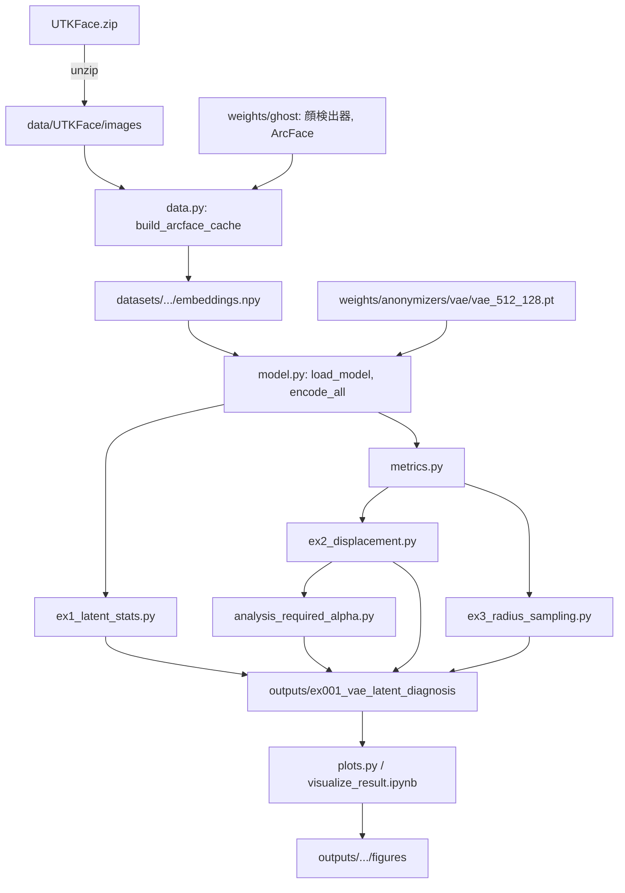
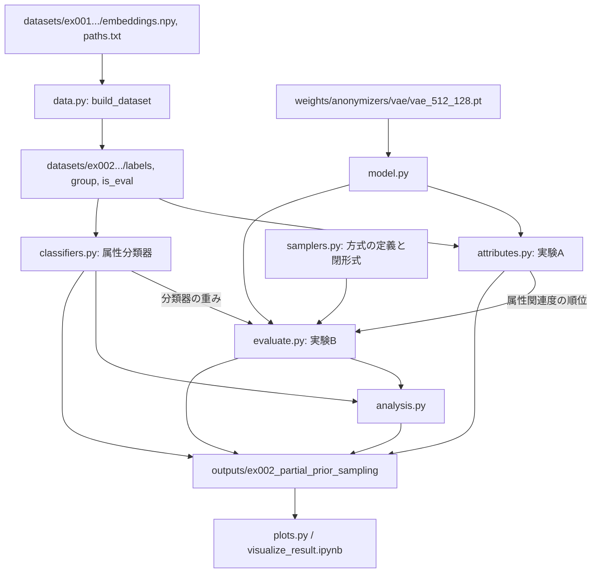
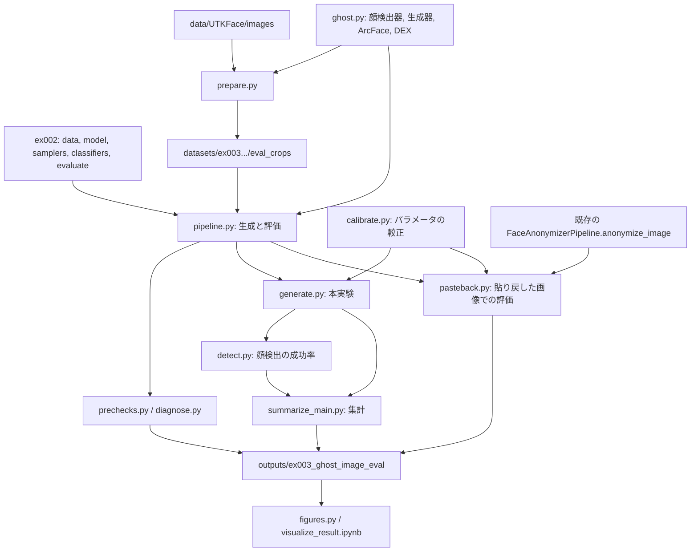
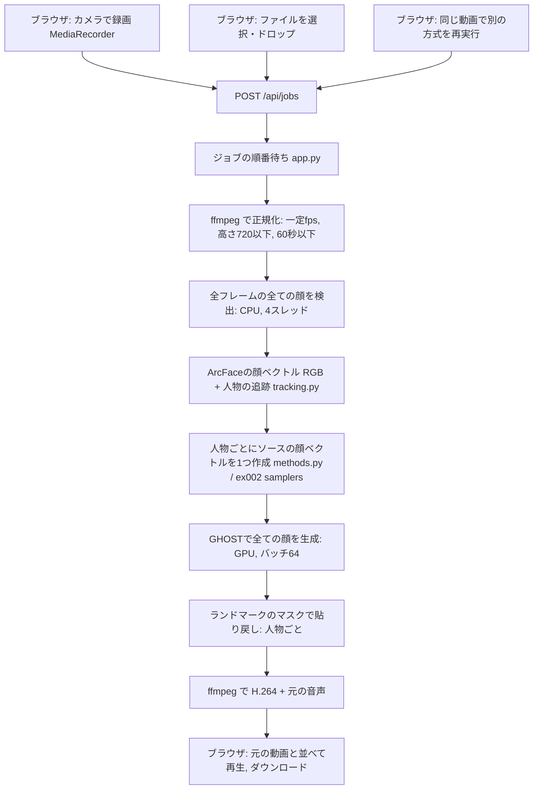

# document.md

本ドキュメントは，`identity_anonymizer.anonymizers.Anonymizer` を継承して新しい匿名化モデルを
実装する方法をまとめたものである．セットアップ・実行方法は [README.md](README.md) を参照すること．

## 1. `Anonymizer` インターフェースの設計方針

GHOSTは，ソース顔として常にArcFaceの512次元埋め込みを要求する．そのため `Anonymizer` は，
**出力**を形状 `(B, 512)` の顔ベクトルに固定する(`output_dim = 512`)．

一方，**入力**の形式・形状はモデルごとに異なってよい．`references/` の予稿・発表資料では，
以下のように入力の異なる複数の手法が紹介されている．

| 手法 | 入力 | 出力 |
| :--- | :--- | :--- |
| 提案手法(`VAEAnonymizer`) | ターゲットのArcFace顔ベクトル $` \mathbf{v} `$ (512次元) | 匿名化後の顔ベクトル $` \hat{\mathbf{v}} `$ (512次元) |
| 従来手法2(`AttributeNNAnonymizer`，本ドキュメントの例) | ターゲットの属性 $` I `$ (性別・年齢・人種) | 顔ベクトル $` \hat{\mathbf{v}} `$ (512次元) |

このように入力の型・次元が手法ごとに異なるため，`Anonymizer` は入力の型を `Any` とし，
各サブクラスが自身の想定する入力を検証する `validate_input` を実装する設計とした．

## 2. `Anonymizer` のAPI(テンプレートメソッドパターン)

`identity_anonymizer/anonymizers/base.py` の `Anonymizer` は，以下の3つのメソッドで構成される．

```text
anonymize(x, **kwargs)              # 公開API．基底クラスが実装する(サブクラスは上書きしない)
  ├─ validate_input(x)              # サブクラスが実装: 入力の型・形状を検証する
  ├─ _anonymize(x, **kwargs)        # サブクラスが実装: 実際の変換処理
  └─ 出力形状 (B, output_dim) の検証  # 基底クラスが実装
```

`anonymize` は，入力検証(`validate_input`) → 実際の変換(`_anonymize`) → 出力形状の検証，を
行うテンプレートメソッドである．この設計により，

- 呼び出し側(`FaceAnonymizerPipeline` 等)は，常に同じ `anonymize(x, **kwargs)` という
  シグネチャでモデルを差し替えられる．
- 各サブクラスは，入力検証を実装し忘れることがない(`anonymize` が必ず `validate_input` を
  呼び出すため)．
- 出力形状が誤っている実装は，`anonymize` の時点で早期に検出される．

## 3. 新しいAnonymizerを実装する手順

1. **入力の形式を決める．** テンソル(顔ベクトル等)である必要はない．dict，dictのlist(バッチ)，
   その他任意の型でよい．
2. **`Anonymizer` を継承したクラスを作成し，`validate_input(self, x)` を実装する．**
   入力 `x` の型・形状・値域が想定と一致するかを確認し，一致しない場合は `TypeError` または
   `ValueError` を送出する．
3. **`_anonymize(self, x, **kwargs) -> torch.Tensor` を実装する．** `validate_input` を
   通過した入力から，形状 `(B, self.output_dim)` の顔ベクトルを生成する．
4. **学習方法を実装する．** 学習手順(教師なし再構成，回帰，敵対的学習等)はモデルごとに
   大きく異なるため，`Anonymizer` では規定しない．`VAEAnonymizer` の学習は
   `notebooks/02_train_vae_anonymizer.ipynb` に，`AttributeNNAnonymizer` の学習は
   `identity_anonymizer.anonymizers.attribute_nn.train_attribute_nn_anonymizer` と
   `notebooks/06_train_attribute_nn_anonymizer.ipynb` に実装している．新しいモデルも同様に，
   `src/identity_anonymizer/anonymizers/<model_name>.py` にモデルとその学習用の関数を実装し，
   `notebooks/0N_train_<model_name>.ipynb` から呼び出す形にすることを推奨する．
5. **`identity_anonymizer.anonymizers.registry.register_anonymizer` へ登録する．**
   登録後は `get_anonymizer("<識別名>")` でインスタンス化できるようになる．
6. **入力がArcFace顔ベクトルではない場合，パイプライン呼び出し時に `anonymizer_input` を
   指定する．** `FaceAnonymizerPipeline.anonymize_image` / `anonymize_video` /
   `get_unified_identity_embedding` は，ターゲット画像・動画から計算したArcFace顔ベクトルを
   常に内部で保持しているが(これは複数人物が映る場合の対象人物の追跡に使うため)，
   `Anonymizer.anonymize` へ渡す入力は `anonymizer_input` 引数で明示的に上書きできる．
   `anonymizer_input=None`(既定値)の場合は，このArcFace顔ベクトルがそのまま
   `Anonymizer.anonymize` の入力として使われる(`VAEAnonymizer` はこの既定動作を利用する)．

## 4. 実装例: `AttributeNNAnonymizer`(従来手法2)

`references/` の予稿・発表資料で紹介されている「従来手法2」(性別・年齢・人種の属性を入力とし，
ArcFaceの顔ベクトルを近似的に出力するNN)を，入力がArcFace顔ベクトルではないAnonymizerの
実装例として `src/identity_anonymizer/anonymizers/attribute_nn.py` に実装した．

### 4.1 入力の形式

年齢(`age`)・性別(`gender`: 0=男性，1=女性)・人種(`race`: 0〜4，UTKFaceの定義に従う)を
キーに持つ `dict`，またはそのバッチ分の `list[dict]` を入力とする．

```python
{"age": 20, "gender": 0, "race": 0}
```

### 4.2 `validate_input` の実装

```python
def validate_input(self, x):
    attributes_list = x if isinstance(x, list) else [x]
    if len(attributes_list) == 0:
        raise ValueError("AttributeNNAnonymizerの入力(属性のリスト)が空です．")
    for attributes in attributes_list:
        if not isinstance(attributes, dict):
            raise TypeError(...)
        for key in ("age", "gender", "race"):
            if key not in attributes:
                raise ValueError(...)
        if attributes["gender"] not in (0, 1):
            raise ValueError(...)
        if not (0 <= attributes["race"] < self.NUM_RACE_CATEGORIES):
            raise ValueError(...)
```

単体(`dict`)とバッチ(`list[dict]`)の両方を受け付けられるよう，`list` でなければ長さ1の
`list` に揃えたうえで，各要素を検証している．

### 4.3 `_anonymize` の実装

属性のdictを，年齢(正規化した1次元)・性別のone-hot(2次元)・人種のone-hot(5次元)からなる
8次元の特徴量へ変換し，3層のMLP(`nn.Linear` → `ReLU` を2回，最後に `nn.Linear` で
`output_dim=512` へ写像)に入力する．

```python
def _anonymize(self, x, **kwargs):
    attributes_list = x if isinstance(x, list) else [x]
    features = self._encode_attributes(attributes_list).to(device)
    return self.net(features)
```

### 4.4 学習

UTKFaceの各顔画像 $` X_n `$ とその属性 $` I_n `$(ファイル名 `{age}_{gender}_{race}_{日時}.jpg`
から取得)の組を用いて，以下の目的関数を最小化する(`train_attribute_nn_anonymizer`)．

$$
\arg\min_{NN} \frac{1}{N} \sum_{n=1}^{N} \| \mathrm{ArcFace}(X_n) - NN(I_n) \|_2
$$

属性と顔ベクトルのペアの抽出には `identity_anonymizer.data.build_attribute_embedding_dataset`
を用いる．`notebooks/06_train_attribute_nn_anonymizer.ipynb` で，同梱のUTKFaceサンプル
(500枚)を用いた学習と，学習済みモデルをパイプラインへ差し替えて属性のみから顔を匿名化する
デモを実行している．

### 4.5 登録と利用

```python
# identity_anonymizer/anonymizers/registry.py
_ANONYMIZER_REGISTRY = {
    "vae": VAEAnonymizer,
    "attribute_nn": AttributeNNAnonymizer,
}
```

```python
from identity_anonymizer.anonymizers import get_anonymizer
from identity_anonymizer.faceswap import load_ghost_models, FaceAnonymizerPipeline

models = load_ghost_models()
anonymizer = get_anonymizer("attribute_nn", weight_path="weights/anonymizers/attribute_nn/attribute_nn.pt")
pipeline = FaceAnonymizerPipeline(models, anonymizer)

# 入力がArcFace顔ベクトルではないため，anonymizer_input で明示的に属性を渡す
face_image, full_image = pipeline.anonymize_image(
    "sample_images/beckham.jpg",
    anonymizer_input={"age": 20, "gender": 0, "race": 0},
)
```

### 4.6 `VAEAnonymizer` との違い・トレードオフ

`AttributeNNAnonymizer` はターゲットの顔画像を必要とせず，属性のみから顔ベクトルを生成できる
反面，**ターゲットの属性を何らかの方法で事前に取得しておく必要がある**．これは `references/`
の予稿でも「従来手法の課題」として指摘されている点であり，`VAEAnonymizer`(ターゲットの顔画像
から直接ArcFace顔ベクトルを計算するため，属性の事前取得が不要)が解決しようとしている課題
そのものである．`AttributeNNAnonymizer` は，この設計上のトレードオフと，`Anonymizer` が
入力の異なるモデルを問題なく扱えることの両方を示す実装例として実装している．

## 5. 関連ファイル

| ファイル | 役割 |
| :--- | :--- |
| `src/identity_anonymizer/anonymizers/base.py` | `Anonymizer` 抽象基底クラス |
| `src/identity_anonymizer/anonymizers/vae.py` | `VAEAnonymizer`(提案手法) |
| `src/identity_anonymizer/anonymizers/attribute_nn.py` | `AttributeNNAnonymizer`(従来手法2，本ドキュメントの例)と学習関数 |
| `src/identity_anonymizer/anonymizers/registry.py` | モデルの登録・取得(`register_anonymizer`, `get_anonymizer`) |
| `src/identity_anonymizer/faceswap/pipeline.py` | `FaceAnonymizerPipeline`(`anonymizer_input` 引数) |
| `src/identity_anonymizer/data/utkface.py` | UTKFaceの属性パース(`parse_utkface_attributes`)とデータセット構築 |
| `notebooks/06_train_attribute_nn_anonymizer.ipynb` | `AttributeNNAnonymizer` の学習・デモの実行例 |
| `tests/test_attribute_nn_anonymizer.py` | `validate_input` の検証を含む単体テスト |

## 6. 実験プログラム: `ex001_vae_latent_diagnosis`

学習済みの `VAEAnonymizer` について，サンプリングのスケール係数(`noise_level`)を大きくしても
匿名化後の顔ベクトルと元の顔ベクトルのコサイン類似度が下がりにくい原因を，ベクトル空間のみで
診断する実験である．VAEの再学習と，GHOSTによる画像生成は行わない．既存の `src/`，`notebooks/`，
`third_party/` は変更せず，読み込むだけである．結果と考察は `.reports/report_001.md` にまとめている．

### 6.1 ディレクトリとファイルの役割

| 場所 | 役割 |
| :--- | :--- |
| `programs/ex001_vae_latent_diagnosis/common.py` | パス，実験条件(`ALPHAS`，`NUM_SAMPLES`，`SEEDS` 等)，保存先の規則 |
| `programs/ex001_vae_latent_diagnosis/env.sh` | 実行に必要な環境変数(`PYTHON`，`LD_LIBRARY_PATH` 等)の設定 |
| `programs/ex001_vae_latent_diagnosis/data.py` | UTKFaceからのArcFace顔ベクトルの抽出(マルチプロセス)とキャッシュの読み込み |
| `programs/ex001_vae_latent_diagnosis/model.py` | 学習済みVAEの読み込みと，全画像のエンコード |
| `programs/ex001_vae_latent_diagnosis/metrics.py` | サンプリング，デコード，最近傍の計算，要約統計量 |
| `programs/ex001_vae_latent_diagnosis/ex1_latent_stats.py` | 実験1: 潜在次元ごとの統計 |
| `programs/ex001_vae_latent_diagnosis/ex2_displacement.py` | 実験2: 潜在空間での移動量と出力の変化 |
| `programs/ex001_vae_latent_diagnosis/ex3_radius_sampling.py` | 実験3: 半径を固定したサンプリングとの比較 |
| `programs/ex001_vae_latent_diagnosis/analysis_required_alpha.py` | 補足: 目標の類似度に必要なスケール係数の見積もりと，類似度のばらつきの内訳 |
| `programs/ex001_vae_latent_diagnosis/plots.py` | 図の描画 |
| `programs/ex001_vae_latent_diagnosis/run_all.py` | 上記を順に実行する入口 |
| `visualize_result.ipynb` | `plots.py` を呼び出して図を保存するノートブック |
| `datasets/ex001_vae_latent_diagnosis/arcface_utkface/` | ArcFace顔ベクトルのキャッシュ(`embeddings.npy`，`paths.txt`，`is_test.npy`，`meta.json`) |
| `outputs/ex001_vae_latent_diagnosis/` | 実験結果(CSV，JSON，npz)と図(`figures/`) |
| `.reports/report_001.md`，`.reports/figures_001/` | レポートと，レポートが参照する図 |
| `.orders/order_001.md` | 実験の指示と，その解釈 |

### 6.2 プログラム間の関係



`run_all.py` は `data.py` → `ex1_latent_stats.py` → `ex2_displacement.py` → `ex3_radius_sampling.py` →
`analysis_required_alpha.py` の順に呼び出す．各処理は保存先に `meta.json` が存在すれば正常終了済みと
みなしてスキップするため，条件を変えて再実行する場合は該当するディレクトリを削除する．

### 6.3 実行方法

```bash
# UTKFaceの展開(初回のみ)．data/UTKFace/ は .gitignore 済み
unzip -q -n UTKFace.zip -d data/

# 環境変数の設定(既存のconda環境 identity-anonymizer を用いる)
source programs/ex001_vae_latent_diagnosis/env.sh

# ArcFaceのキャッシュ，実験1〜3，補足の解析を一括で実行する
$PYTHON programs/ex001_vae_latent_diagnosis/run_all.py --num_workers 4

# 図の生成(outputs/ex001_vae_latent_diagnosis/figures/ に保存される)
$PYTHON -m jupyter nbconvert --to notebook --execute --inplace visualize_result.ipynb
```

ArcFaceの抽出は4プロセスで約13分，実験1〜3は合計で1分程度である．抽出時の1プロセスあたりの
最大使用量はDRAMが約5.3 GiB，VRAMが約1.0 GiBであった．

### 6.4 保存される結果

結果は `outputs/ex001_vae_latent_diagnosis/{実験}/{条件}/{seed}/` に保存される．

| 実験 | 主なファイル |
| :--- | :--- |
| `ex1_latent_stats/all_images/0/` | `per_dim_stats.csv`(次元ごとの統計)，`summary.json`(活性次元数等の集計) |
| `ex2_displacement/K10/{seed}/` | `summary_by_alpha.csv`(スケール係数ごとの平均・分位点)，`baselines_summary.csv`(比較基準)，`per_sample_metrics.npz`，`per_image_baselines.npz` |
| `ex3_radius_sampling/K10/{seed}/` | `gauss_vs_shell_tests.csv`(検定と効果量)，`summary_by_variant.csv`，`scaling_equivalence.csv`，`cos_v_per_sample.npz` |
| `ex2_required_alpha/closed_form/0/` | `required_alpha.csv`，`within_image_spread.csv` |

### 6.5 環境に関する注意

- 仮想環境は，リポジトリが採用しているconda環境 `identity-anonymizer`(`environment.yml`)を
  そのまま用いる．追加のライブラリは不要である．
- `mxnet-cu112` が読み込めない環境でも実行できるよう，`data.py` は顔検出器とArcFaceのみを
  読み込む．前処理は `identity_anonymizer.data.utkface` と同一である．
- `insightface==0.2.1` と `onnxruntime-gpu==1.14.0` の組み合わせで発生する例外を避けるため，
  `data.py` は実行中のプロセス内に限って `onnxruntime.InferenceSession` の providers の既定値を
  補う．site-packages は書き換えない．
- `datasets/`，`outputs/`，`UTKFace.zip`，`data/UTKFace/` はGitの管理対象外である．

## 7. 実験プログラム: `ex002_partial_prior_sampling`

学習済みの `VAEAnonymizer` を再学習せずに，「属性(性別・年齢・人種)に関連する潜在次元は
事後分布から，それ以外の次元は事前分布から取る」サンプリングを，現行方式・比較対象・対照と
ベクトル空間のみで比べる実験である．GHOSTによる画像生成は行わない．既存の `src/`，`notebooks/`，
`third_party/` は変更しない．結果と考察は `.reports/report_002.md` にまとめている．

### 7.1 ディレクトリとファイルの役割

| 場所 | 役割 |
| :--- | :--- |
| `programs/ex002_partial_prior_sampling/common.py` | パス，実験条件(各方式で掃引するパラメータ，`SEEDS`，`NUM_SAMPLES` 等) |
| `programs/ex002_partial_prior_sampling/env.sh` | 実行に必要な環境変数の設定 |
| `programs/ex002_partial_prior_sampling/data.py` | ファイル名からのラベルの取得，重複グループ化，重複グループを単位とする8:2の分割 |
| `programs/ex002_partial_prior_sampling/model.py` | 学習済みVAEの読み込みと，エンコード |
| `programs/ex002_partial_prior_sampling/attributes.py` | 実験A: 潜在次元ごとの属性関連度と，一部の次元を使った線形分類器の精度 |
| `programs/ex002_partial_prior_sampling/classifiers.py` | 評価用の属性分類器(性別・人種・年齢)の学習と適用 |
| `programs/ex002_partial_prior_sampling/samplers.py` | 比較する方式(M0，M1，M1b，M2，M2r，M3，M3u)の定義と，類似度の閉形式 |
| `programs/ex002_partial_prior_sampling/evaluate.py` | 実験B: 各方式のサンプリングと指標(類似度，再識別率，属性の保持，自然さ，多様性)の計算 |
| `programs/ex002_partial_prior_sampling/analysis.py` | 同じ類似度・同じ再識別率での比較表，方式間の差，閉形式の誤差，分類器の重みの分解 |
| `programs/ex002_partial_prior_sampling/plots.py` | 図の描画 |
| `programs/ex002_partial_prior_sampling/run_all.py` | 上記を順に実行する入口 |
| `datasets/ex002_partial_prior_sampling/labels_groups_split/` | ラベル，重複グループ，分割(`labels.npy`，`has_label.npy`，`group.npy`，`is_eval.npy`，`meta.json`) |
| `outputs/ex002_partial_prior_sampling/` | 実験結果と図(`figures/`) |
| `.reports/report_002.md`，`.reports/figures_002/` | レポートと，レポートが参照する図 |
| `.orders/order_002.md` | 実験の指示と，その解釈 |

### 7.2 プログラム間の関係



ArcFaceの顔ベクトルは `ex001_vae_latent_diagnosis` のキャッシュを再利用するため，先に6章の手順で
キャッシュを作成しておく必要がある．各処理は保存先に `meta.json` が存在すれば正常終了済みとみなして
スキップする．`analysis.py` のみ，毎回再計算する．

### 7.3 実行方法

```bash
source programs/ex002_partial_prior_sampling/env.sh

# ラベルと分割の作成，実験A，属性分類器の学習，実験B，集計を一括で実行する
$PYTHON programs/ex002_partial_prior_sampling/run_all.py

# 図の生成(outputs/ex002_partial_prior_sampling/figures/ に保存される)
$PYTHON -m jupyter nbconvert --to notebook --execute --inplace visualize_result.ipynb
```

全体で10分程度である．属性分類器の学習が数分，実験Bが1シードあたり1分程度を占める．

### 7.4 保存される結果

| 実験 | 主なファイル |
| :--- | :--- |
| `expA_attribute_relevance/mu/0/` | `relevance_all_images.csv`(全画像での属性関連度)，`relevance_train_split.csv`(実験Bで用いる順位)，`probe_accuracy.csv`，`summary.json` |
| `classifiers/{raw,l2}/0/` | `weights.npz`(標準化を畳み込んだ線形モデルの重み)，`meta.json`(学習用・評価用・再構成での精度) |
| `expB_sampling/K10/{seed}/` | `summary.csv`(設定ごとの平均と5%・95%点，閉形式による予測)，`per_image.npz`(画像ごとの指標) |
| `expB_analysis/K10/0/` | `matched_cosine_*.csv`，`matched_reid_*.csv`，`contrasts.csv`，`closed_form_error.csv`，`classifier_weight_decomposition.csv` |

`raw` は正規化しない顔ベクトルで学習した分類器，`l2` はL2正規化した顔ベクトルで学習した分類器である．
`summary.csv` の指標名のうち，接頭辞 `l2_` が付くものは後者による評価である．

## 8. 実験プログラム: `ex003_ghost_image_eval`

GHOSTで実際に顔画像を生成し，生成画像から再抽出したArcFaceの顔ベクトルによる再識別率と，
DEXによる年齢・性別の推定で，匿名性と属性の保持を評価する実験である．
作業前の確認(予稿の再現など)の結果は `.reports/report_003.md`，本実験と，生成した顔を元画像へ
貼り戻した画像での評価の結果は `.reports/report_004.md` にまとめている．

### 8.1 ディレクトリとファイルの役割

| 場所 | 役割 |
| :--- | :--- |
| `programs/ex003_ghost_image_eval/settings.py` | パス，実験条件．ex002 の実装を読み込むための設定．`mxnet` と `dill` が無い環境での代用 |
| `programs/ex003_ghost_image_eval/env.sh` | 既存の環境 `identity-anonymizer` で実行するための環境変数 |
| `programs/ex003_ghost_image_eval/env_mxcpu.sh` | 貼り戻しに用いる環境 `identity-anonymizer-mxcpu` で実行するための環境変数と，その環境の作り方 |
| `programs/ex003_ghost_image_eval/ghost.py` | 顔検出器・生成器・ArcFace・DEXの読み込み，顔の切り出し，生成，再抽出，DEXの推定(バッチ処理) |
| `programs/ex003_ghost_image_eval/prepare.py` | 評価用データ4,614枚の顔の切り出しのキャッシュ，本実験用1,000枚の層化抽出，再現用200枚の抽出 |
| `programs/ex003_ghost_image_eval/pipeline.py` | ソースの顔ベクトルから生成・評価までの一連の処理と，設定ごとの要約 |
| `programs/ex003_ghost_image_eval/prechecks.py` | 予稿の再現，リポジトリのnotebookの記録との照合，DEXの精度，線形分類器の健全性 |
| `programs/ex003_ghost_image_eval/diagnose.py` | 再現のずれの切り分け(年代別の内訳，画像の集合の年齢の構成，DEXの入力の違い) |
| `programs/ex003_ghost_image_eval/calibrate.py` | 再識別率の目標値に相当するパラメータの，ベクトル空間での較正 |
| `programs/ex003_ghost_image_eval/generate.py` | 本実験(全設定の生成と評価)．`--trial` で50枚の試行 |
| `programs/ex003_ghost_image_eval/detect.py` | 生成画像での顔検出の成功率 |
| `programs/ex003_ghost_image_eval/summarize_main.py` | 本実験の集計(再識別率をそろえた比較，方式間の対応のある比較，ノルムの補正の効果，ベクトル空間との対応) |
| `programs/ex003_ghost_image_eval/pasteback.py` | 既存の `anonymize_image` で貼り戻した画像を作り，DEXとArcFaceへの入力を変えて評価する |
| `programs/ex003_ghost_image_eval/figures.py` | 図の描画 |
| `datasets/ex003_ghost_image_eval/eval_crops/` | 切り出した顔画像(`target224.npy`，`resized256.npy`)と，抽出した画像の番号 |
| `outputs/ex003_ghost_image_eval/` | 結果(下表)と図(`figures/`) |
| `.reports/report_003.md`，`.reports/report_004.md`，`.reports/figures_003/`，`.reports/figures_004/` | レポートと，レポートが参照する図 |

サンプリング方式，VAEの読み込み，ラベル・重複グループ・データ分割，線形の属性分類器，再識別率の計算は，
`programs/ex002_partial_prior_sampling/` のモジュールを読み込んで再利用する．

| 結果の場所 | 内容 |
| :--- | :--- |
| `prechecks/default/0/` | 予稿の再現，notebookの記録との照合，DEXの精度，線形分類器の健全性，ずれの切り分け |
| `calibration/n1000_K10/0/` | `sweep.csv`(ベクトル空間での掃引)，`chosen.csv`(選んだパラメータ) |
| `trial/n50/0/`，`main/n1000/0/` | `summary.csv`(設定ごとの要約)，`per_image.npz`，`originals.npz`，`detection.csv`，`generated/`(生成画像，約7.4GB) |
| `main_analysis/n1000/0/` | `matched_image_reid.csv`，`paired_methods.csv`，`norm_effect.csv`，`correspondence.csv` |
| `pasteback_reproduction/n200/0/`，`pasteback_other/n200/0/`，`pasteback_main/n1000/0/` | 貼り戻した画像での評価の `summary.csv` と `per_image.npz` |

### 8.2 プログラム間の関係



### 8.3 実行方法

```bash
source programs/ex003_ghost_image_eval/env.sh

# 顔の切り出しと画像の抽出(4並列で約6分)
$PYTHON programs/ex003_ghost_image_eval/prepare.py --num_workers 4

# 作業前の確認(線形分類器の健全性に約10分)
$PYTHON programs/ex003_ghost_image_eval/prechecks.py
$PYTHON programs/ex003_ghost_image_eval/diagnose.py

# 本実験(較正 → 50枚の試行 → 1,000枚．本実験は約6分)と，顔検出，集計
$PYTHON programs/ex003_ghost_image_eval/calibrate.py
$PYTHON programs/ex003_ghost_image_eval/generate.py --trial
$PYTHON programs/ex003_ghost_image_eval/generate.py
$PYTHON programs/ex003_ghost_image_eval/detect.py --num_workers 4
$PYTHON programs/ex003_ghost_image_eval/summarize_main.py

# 貼り戻した画像での評価(mxnet が必要なため，別の環境で実行する)
source programs/ex003_ghost_image_eval/env_mxcpu.sh
$PYTHON programs/ex003_ghost_image_eval/pasteback.py --target reproduction   # 200枚，約10分
$PYTHON programs/ex003_ghost_image_eval/pasteback.py --target other          # 200枚，約2分
$PYTHON programs/ex003_ghost_image_eval/pasteback.py --target main           # 1,000枚，約50分
```

### 8.4 環境に関する注意

- 生成器が出力した顔画像での評価(`generate.py` まで)は，既存のconda環境 `identity-anonymizer` を
  そのまま用いる．GHOSTのうち mxnet を必要とするのは，生成した顔を元画像へ貼り戻す処理
  (`get_final_image`)だけであるため，`settings.py` は `mxnet` と `dill` が import できない場合に
  空のモジュールで代用する．
- 貼り戻した画像での評価(`pasteback.py`)は，既存の環境を複製した `identity-anonymizer-mxcpu` を用いる．
  作り方は次のとおりである．既存の環境は変更しない．

  ```bash
  conda create -y -n identity-anonymizer-mxcpu --clone identity-anonymizer
  ~/miniconda3/envs/identity-anonymizer-mxcpu/bin/pip uninstall -y mxnet-cu112
  ~/miniconda3/envs/identity-anonymizer-mxcpu/bin/pip install --no-deps mxnet==1.9.1 dill numpy==1.23.5
  ```

  `numpy` を下げるのは，`mxnet` 1.9.1 が `numpy` 1.24 以降では import できないためである．
- 既存の `load_ghost_models` はランドマーク検出器をGPUで初期化するため，CPU版の mxnet では動かない．
  `pasteback.py` はモデルの読み込みだけを自前で行い，生成と貼り戻しは既存の `anonymize_image` を呼び出す．
- `generate.py` は生成画像を設定ごとに `.npy` で保存する．1,000枚・40設定で約7.4GBになる．


## 9. 匿名化デモ: `programs/demo`

ブラウザで撮影した動画，またはローカルの動画ファイルを受け取り，選んだ方式で動画に映る全員の顔を
匿名化して，ブラウザで再生できる動画として返すWebアプリケーションである．同じ人物は動画全体で同じ
架空の人物に置き換わる．リアルタイム処理ではなく，録画済みの動画をまとめて処理する．

### 9.1 ファイルの役割

| ファイル | 役割 |
| :--- | :--- |
| `programs/demo/app.py` | Webサーバー(FastAPI)．動画の受け付け，ジョブの順番待ち(GPUは1つのため1本ずつ処理)，進捗と結果の返却 |
| `programs/demo/engine.py` | 匿名化の処理(動画の正規化 → 全フレームの全ての顔の検出 → 人物の追跡 → 人物ごとのソースの顔ベクトルの作成 → GHOSTによる生成 → 貼り戻し → H.264 への変換) |
| `programs/demo/tracking.py` | 複数の人物の追跡(ArcFaceの顔ベクトルの類似度によるハンガリアン法と，顔の位置による補完) |
| `programs/demo/methods.py` | ブラウザから選べる方式(M3u，M2，M3，M0，Self)とパラメータ・プリセットの定義，ソースの顔ベクトルの作成 |
| `programs/demo/demo_settings.py` | 入力の制限(長さ60秒，高さ720画素，30 fps，500MB)，追跡の閾値，既存のモジュールを読み込むためのパス |
| `programs/demo/static/` | ブラウザの画面(`index.html`，`app.js`，`style.css`) |
| `programs/demo/assets/attribute_ranking.json` | M2・M3 で保持する次元の順位(ex002 の実験Aの属性関連度) |
| `programs/demo/env.sh`，`programs/demo/requirements_demo.txt` | 実行環境の設定と，デモ用に追加したライブラリ |
| `tests/test_demo_tracking.py` | 人物の追跡のテスト(pytest) |
| `outputs/demo/jobs/` | ジョブごとの入力・変換後の動画・匿名化後の動画・`summary.json`(Git管理外．保持するのは直近20件) |

方式の実装は ex002 の `samplers.py`，モデルの読み込みとGHOSTの生成は ex003 の `ghost.py` を読み込んで
再利用する．顔の切り出し，ランドマークの平滑化，貼り戻しは，GHOSTの `crop_frames_and_get_transforms`，
`smooth_landmarks`，`get_final_video` と同じ関数・同じ手順を，複数の人物に対して適用したものである．

### 9.2 処理の流れ



### 9.3 実行方法

```bash
# 初回のみ: 貼り戻し用の環境 identity-anonymizer-mxcpu を作り(8.4節)，デモ用のライブラリを追加する
~/miniconda3/envs/identity-anonymizer-mxcpu/bin/pip install -r programs/demo/requirements_demo.txt

source programs/demo/env.sh
$PYTHON programs/demo/app.py --host 127.0.0.1 --port 8000
# ブラウザで http://127.0.0.1:8000 を開く(モデルの読み込みに約10秒かかる)

# テスト
$PYTHON -m pytest tests/test_demo_tracking.py
```

- 外部コマンドとして `ffmpeg` と `ffprobe` が必要である．
- カメラでの撮影には安全なコンテキストが必要であり，`localhost` で開くか，HTTPS で公開する必要がある．
  WSL2 の場合，Windows のブラウザから `http://localhost:8000` で開けばカメラを使える．IPアドレス
  (例: `http://192.168.x.x:8000`) で開いた場合や，VS Code の内蔵ブラウザのようにページを埋め込んで表示する
  画面では，ブラウザの制限でカメラを使えない．画面はこれを開いた時点で検出し，理由を表示して
  「ファイルを選択」に切り替える．
- 既定では `127.0.0.1` でのみ待ち受ける．他の端末から使う場合は，Cloudflare Tunnel で `https://` の
  URLを発行して公開する(手順は [README.md](README.md) の「ブラウザで使う匿名化デモと，外部からのアクセス」)．
  デモには認証が無いため，継続して公開する場合は Cloudflare Access で利用者を制限すること．
- 処理時間の目安(RTX 4090)は，1人が映る640×360・30 fpsの動画で動画の長さの約1.5倍，
  2人が映る1280×360・8秒の動画で約30秒である．顔検出と貼り戻しがCPUで動くため，これらが大半を占める．
- 「弱・中・強」のプリセットは，report_004 の較正でベクトル空間での再識別率が約0.9・0.5・0.1になる
  パラメータである．貼り戻した画像では本人の特徴が一部戻るため，実際の再識別率はこれより高い．
- 匿名化モデルに渡す顔ベクトルは，VAEの学習時と同じRGBの順序の顔画像から計算する(既存の
  `anonymize_image` にある色チャネルの不整合は，デモ側で回避している．report_004 の8.6節)．
